# Panticapaeum: Echoes of the Bosporus

**[Играть в браузере](https://stadytady.github.io/metridat-game/)** · **[Скачать v0.0.6](https://github.com/stadytady/metridat-game/releases/tag/v0.0.6)** (Windows, Linux) · **[Трейлер](docs/trailer.mp4)**

Поздний день, IV век до нашей эры. Вы стоите на холме над Киммерийским Боспором — проливом между Чёрным и Азовским морями. Внизу Пантикапей: черепичные крыши, ступенчатые улицы, площадь, святилище на террасе. По проливу идут корабли с зерном. Дальний берег тонет в дымке.

Это прогулка от первого лица по городу, которого больше нет, в манере игр для первой PlayStation: низкое разрешение, дрожащие полигоны, дизеринг, туман. Здесь не надо ни с кем сражаться и не нужно торопиться. Надо смотреть, находить вещи и слушать людей, а когда стемнеет — зажечь огни на обратном пути.

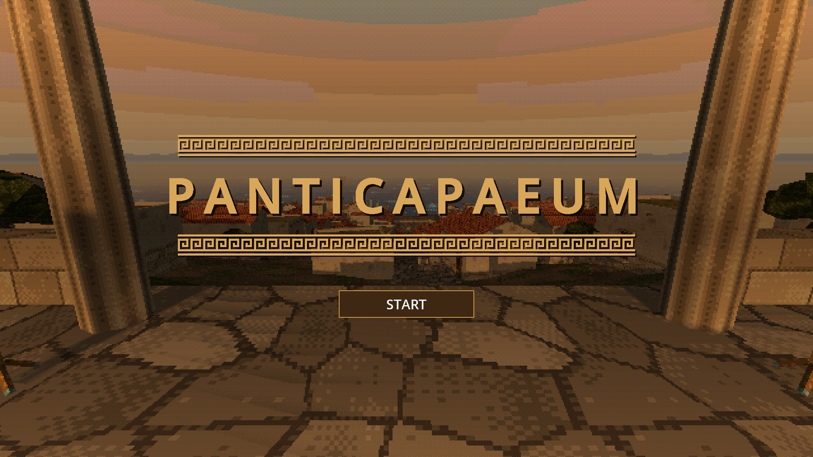

## О чём игра

Пантикапей основали выходцы из Милета на рубеже VII–VI веков до н. э. на горе, которую сегодня называют Митридат, — это нынешняя Керчь. В IV веке город был столицей Боспорского царства. Здешнее зерно кормило Афины, а афинские вазы и вино плыли обратно. Об этом мире почти всё известно по вещам из земли: черепкам, клеймам на амфорах, монетам, надписям.

Игра построена так же. Восемь находок разбросаны по городу. Каждая открывает три страницы:

- что это за предмет;
- что о таких вещах известно историкам, со ссылками на источники;
- маленькую выдуманную историю — и она прямо так и подписана.

С каждой находкой день клонится к вечеру: солнце садится, небо краснеет, корабли с пролива подходят к берегу и встают на якорь, затем приходят звёзды и луна, а на кормах зажигаются фонари. Последняя находка приносит ночь. Тогда остаётся одно: вернуться на холм, зажигая по дороге светильники.

## Прогулка

Неспешный проход — примерно четверть часа, а можно бродить сколько угодно. Загрузок нет: это одна непрерывная сцена.

**Холм над проливом.** Мощёная терраса, разрушенный парапет, упавшие барабаны колонн. Две уцелевшие колонны обрамляют вид на город и море. В западной половине террасы — маленький театр: три низких яруса каменных сидений полукругом над орхестрой, с видом на пролив. Рядом стоит деревянный стенд с масками, трагическими и комическими, а в орхестре репетирует актёр Федр — играет смерть царя перед пустыми рядами. По склонам вокруг террасы растут кусты олив. На запад, за парапет, открывается степь: сухая золотая трава до дымки, курганы с каменными бабами, длинные гребни на горизонте — и отара овец в загоне под террасой, которая пасётся, бродит и изредка блеет. Отсюда начинается спуск.

**Улица кувшинов.** Узкая ступенчатая улица между домами на каменном цоколе. Стены оштукатурены, у дверей стоят амфоры. В первом же дворе среди пифосов копошатся куры — и лежит амфора с клеймом. Город обжит и стоит так, как стоял Пантикапей: склоны изрезаны террасами на подпорных стенах, вдоль каждой террасы по склону вьётся улица с домами по обе стороны, а вниз между террасами сбегают крутые переулки-лестницы; над крышами днём из глиняных дымников и дымовых отверстий поднимается дым очагов, а с сумерками в окнах загораются масляные лампы — огонь в каждом окне дышит и вздрагивает сам по себе: на мостовой валяются черепки разбитого горшка, у стены забыта корзина, на паре крыш не хватает черепиц, во дворе на верёвке сохнет ткань.

**Агора.** Главная площадь: стоя с дорическими колоннами, прилавок под тканевым навесом, постамент, с которого давно сняли бронзовую статую. В юго-западном углу — мастерская гончара Каллия. Он сидит за кругом, мальчик-подмастерье крутит круг рукой, рядом дымит печь. За печью сложены дрова, у колоды для рубки рассыпана щепа. Перед мастерской гуляет петух со своими курами. У торца стои спит большая собака, изредка дёргая ухом. Перед стоей колодец под деревянной рамой со шкивом: женщина перебирает верёвку, рядом ждёт гидрия. Посреди площади клюют голуби — подойдёте, и стайка вспорхнёт на край крыши стои, а минуты через две-три по одному вернётся вниз. Камень у входа на площадь стёрт до светлого тысячами ног. Подойдёте слишком близко — с криком разбегутся.

**Домик у моря.** Самый восточный дом на правой руке, когда спускаешься к воде, — у городской стены. Дверь открыта: внутри ровный земляной пол, потолок, скамья и полка с лампой, света хватает. Справа от двери на кронштейне висит глиняная лампа, и в сумерках она загорается вместе с остальным городом.

**Дом Мирто.** Через проход в южном парапете агоры тропинка ведёт к дому, в который можно войти. Во дворе на коленях у глиняной печи-тануру Мирто печёт лепёшки: хлопает тесто тонко и лепит его на горячую стенку. С ней можно поговорить. Под навесом две комнаты: в одной — очаг, ложе с овчиной и полка с горшками, в другой — вертикальный ткацкий станок с глиняными грузилами на нитях основы, корзина шерсти и светильник.

**Пляж.** Через проём в восточном парапете тропа спускается к морю. Над берегом и стоянкой кораблей кружат чайки. На песке лежит вытащенная лодка, на распорках сохнет сеть, горит костёр. Рыбак Главк чинит сеть, сидя на камне, и охотно расскажет, как зимой пролив замерзает так, что по льду ездят повозки, — а напоследок посоветует не задерживаться на берегу после темноты. Чуть севернее в пролив уходит деревянная пристань. У неё под парусом стоит торговый корабль «Ласточка»: один моряк несёт амфору к сходням, другой сидит на краю настила и сращивает канат, а кормчий Дамон рассказывает, чего ночью лучше не видеть. Вечером на конце пристани зажигают фонарь.

**Святилище Гекаты.** У нижних ворот, где дорога с агоры встречает лестницу, стоят миски с хлебом и лепёшками — «ужин Гекаты», богини перекрёстков и ночи. Лестница между кипарисами поднимается на террасу. Наверху чаша с водой — омыть руки. Храм стоит на трёх ступенях, двери открыты, и в глубине при свете лампы видна трёхликая Геката с факелами. Перед храмом алтарь с огнём и венками, бронзовый треножник, полка с глиняными статуэтками. Вдоль западной ограды под навесом лежат овечьи шкуры: сюда приходят спать ради снов. В сумерках огонь алтаря видно издалека, ночью у дверей храма горят два факела.

**Ночь.** Вдоль пути стоят 17 бронзовых светильников с масляными лампами и факелы. Их можно зажечь. Ночью город меняется. У входа на агору горит лампа у «ужина Гекаты». Собака у стои просыпается и смотрит в сторону святилища, а где-то за ним воют псы. В глубине улицы стоит фигура в чёрной тоге с глубоким капюшоном, под которым нет лица, — и, когда подходишь, рассыпается по пикселям и исчезает. Над проливом, дальше стоящих на якоре кораблей, бродит бледный огонёк — тот самый, о котором предупреждал рыбак. Его рыба так и лежит на камне у воды. Когда путь освещён, остаётся вернуться в святилище Гекаты и лечь на свободную шкуру в абатоне.

**Сон.** Тропа из камней, вдоль неё кусты олив и мёртвые деревья, уходит в густой ночной туман, луна светит ярче обычного, звуки города стихают — остаются низкий гул и где-то впереди вой собаки, животного Гекаты. Впереди на тропе стоит кто-то в чёрном капюшоне — и, когда подходишь, рассыпается и исчезает. Трижды. В конце тропы курган с каменным порталом и алтарь перед ним, а на алтаре у маленькой масляной лампы стоит бронзовое зеркало. Стоит в него заглянуть — и в тишине со скрипом отворяются двери кургана. За ними длинная лестница уходит под землю, под ступенчатый свод: каждый ряд камней выступает над нижним, пока ряды не сойдутся. На полпути на уступе горит лампа. Внизу — квадратная погребальная камера с таким же ступенчатым куполом, амфоры по углам, кратер, лампа в нише. На каменном ложе под овчиной спит человек — так же, как ты лёг в абатоне, у головы золотой венок. Склонишься над ним — КОНЕЦ, титры, и можно проснуться в абатоне и гулять дальше ночным городом.

Девятая находка — зеркало из сна: она не входит в счёт городских восьми и появляется в журнале, только когда найдена.

Каждую найденную вещь можно рассмотреть: в панели находки она лежит крупно, медленно поворачивается, её можно покрутить мышью и приблизить колесом.

Потерялись? Клавиша **J** открывает журнал: найденное — с названием и местом (щелчок откроет его снова), ненайденное — с подсказкой, где искать.

Клавиша **Tab** открывает «Путь»: четыре задачи с полосками прогресса и восемь достижений — закрытые с условием, открытые с галочкой. Достижения выдаются сами: справа внизу выезжает карточка с кубком и коротким звоном.

| | |
|---|---|
| 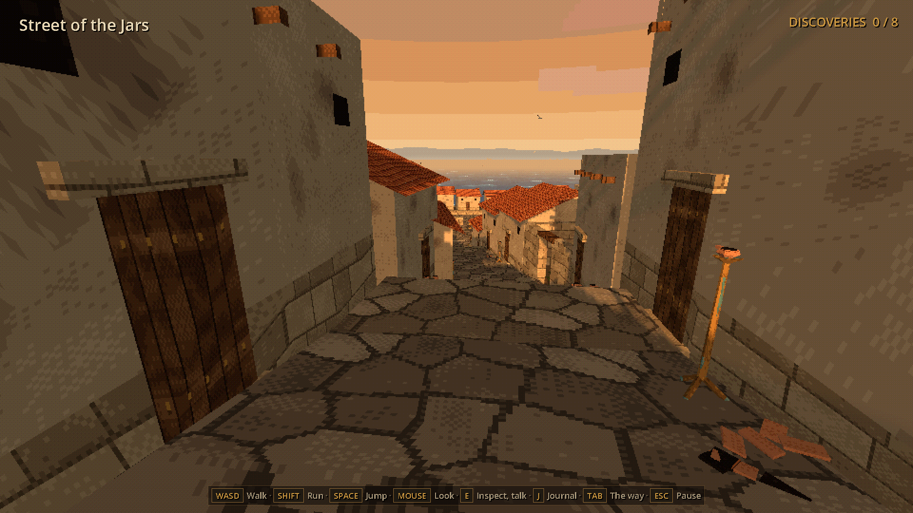 | 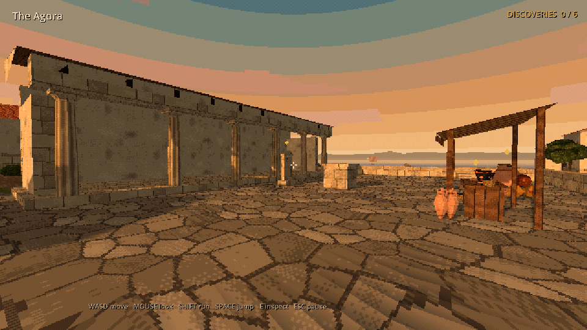 |
| 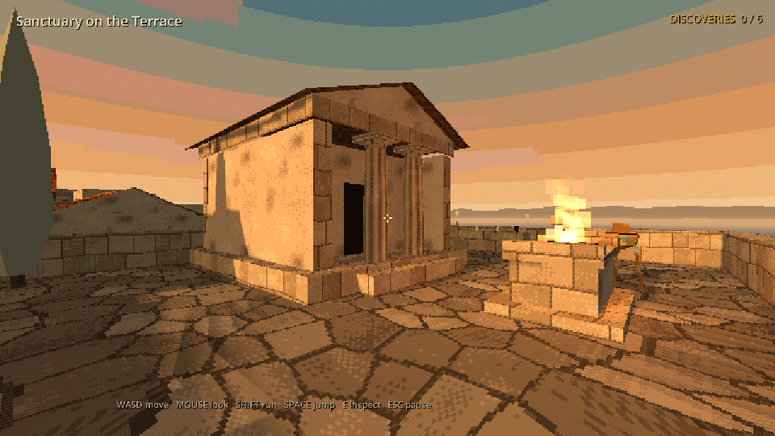 | 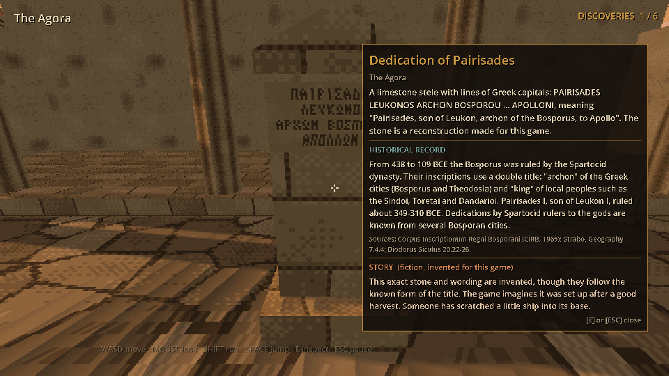 |
| 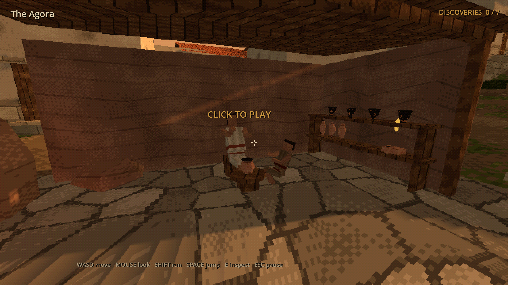 | 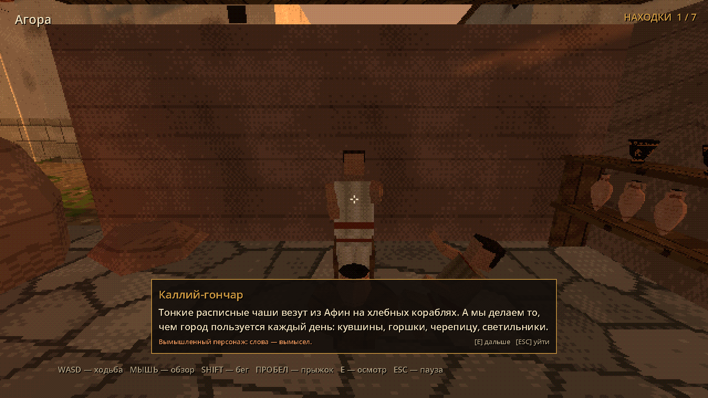 |
| 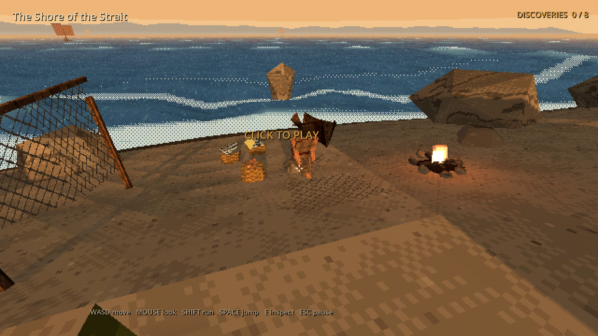 | 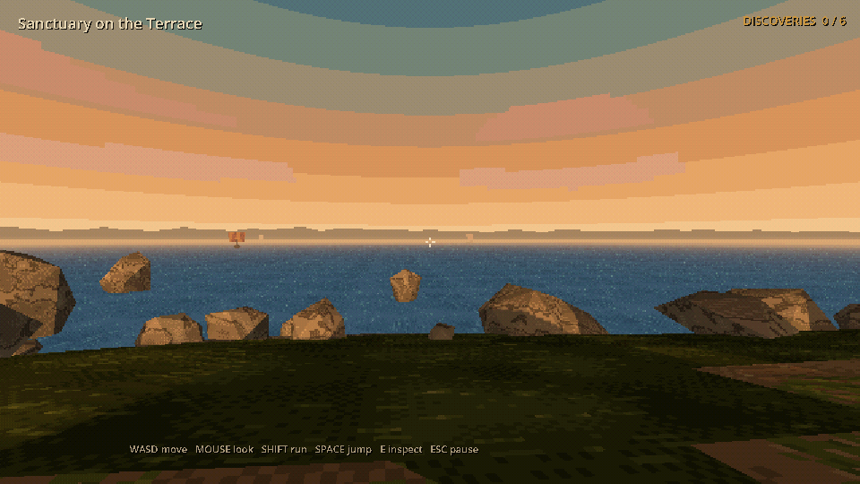 |
| 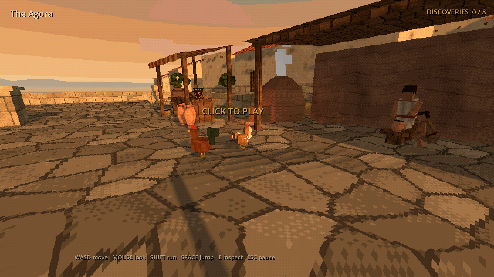 | 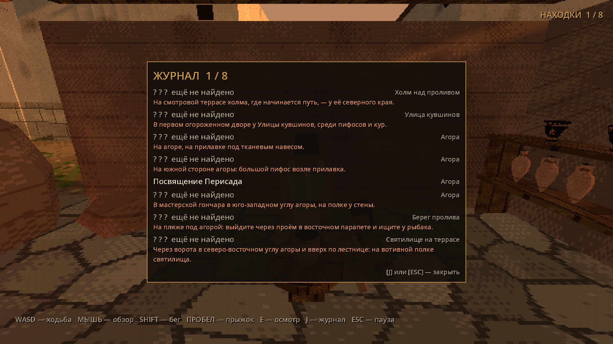 |
| 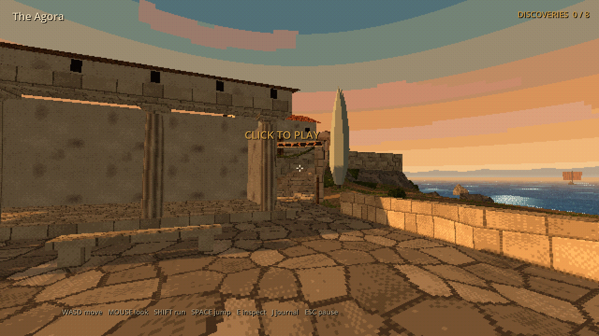 | 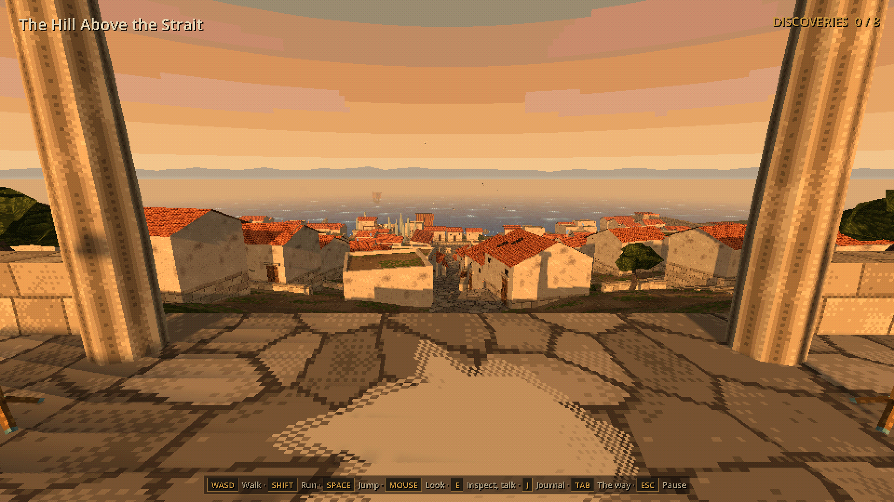 |
| 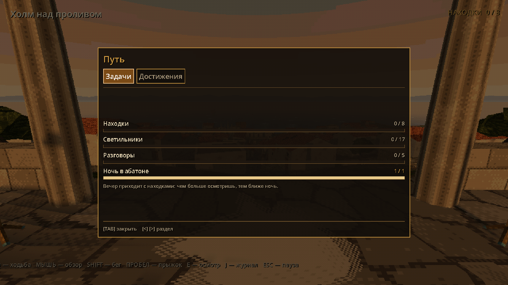 | 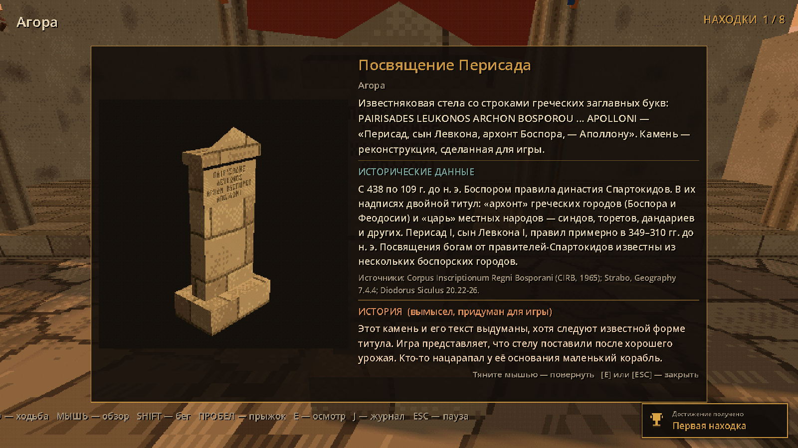 |
| 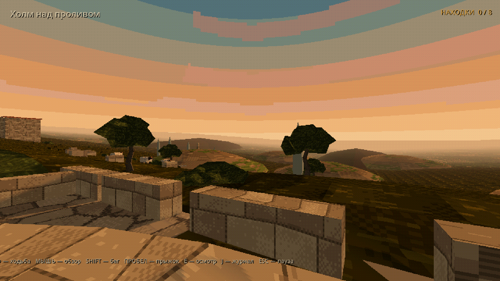 | 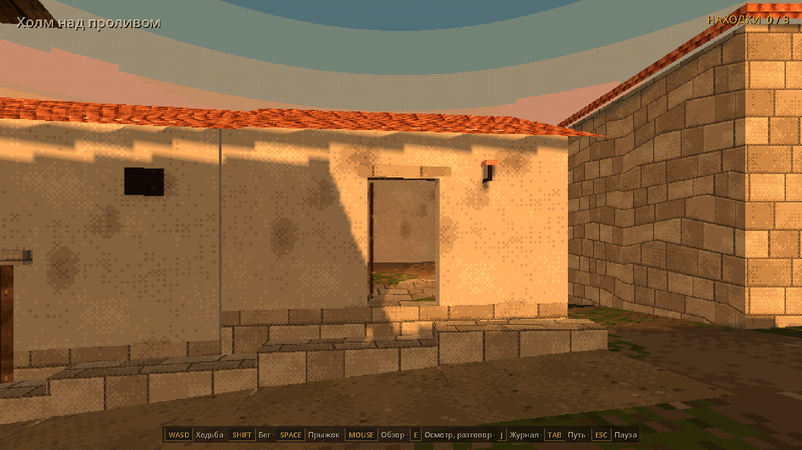 |
| 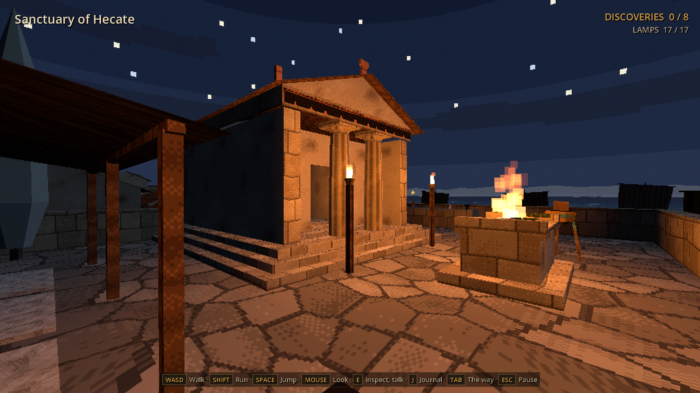 | 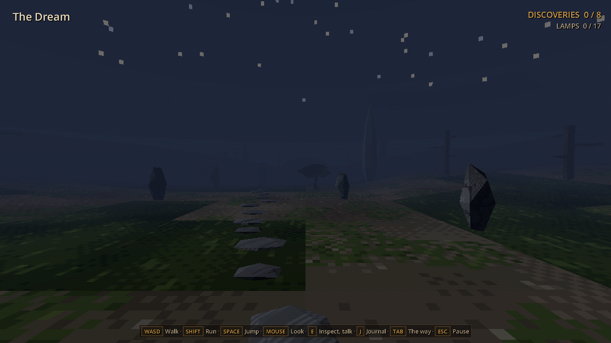 |

## Правда и вымысел

Игра старается честно разделять одно и другое.

- В «Исторических данных» только то, что принято в литературе, и у каждой находки указаны источники: Геродот, Страбон, Демосфен, свод боспорских надписей (CIRB), работы Schefold, Boardman, Higgins, Højte, MacDonald и другие.
- Гончар Каллий, рыбак Главк, виноторговец Формион, текст стелы и святилище Гекаты на террасе придуманы. Сам культ Гекаты у греков реален, а посвящение этого святилища ей — вымысел игры. Они появляются только в разделах «История — вымысел» и в разговорах, а панель разговора помечена: «Вымышленный персонаж: слова — вымысел». Факты, на которые намекают персонажи, лежат в соседней находке с источниками.
- Архитектура вдохновлена греческими городами Северного Причерноморья: каменный цоколь и штукатурка, черепица, дорический ордер, без римских арок и куполов. Реальная топография Пантикапея и горы Митридат упрощена.
- Сон, тропа, фигура и курган с зеркалом — вымысел. Ночлег в святилище ради сна (инкубация) — реальный греческий обычай, известный по святилищам Асклепия и Амфиарая; для Пантикапея он не засвидетельствован. Боспорские курганы с каменными коридорами-дромосами реальны, этот — нет. Своды коридора и камеры сложены по их образцу: ступенчатый («ложный») свод из выступающих рядов камня и квадратная камера под таким же куполом, как в Царском кургане под Керчью (IV век до н. э.). Длинная лестница вглубь — вольность сна: в Царском кургане дромос лестницей под землю не уходит. Спящий двойник, двери и всё, что лежит в камере, — вымысел.
- Пролив сужен: при настоящей ширине противоположный берег не был бы виден сквозь туман.
- Уличного освещения у греков не было. Ряд огней вдоль дороги — игровая условность, но сами светильники, лампы и факелы — той эпохи.

## Как это выглядит

Так, как могла бы выглядеть игра 1999 года. Картинка рисуется в низком разрешении — 960×540 на экране 1080p (480 строк на 1440p, 360 на 720p, масштаб всегда целый) — и растягивается без сглаживания. Цвет 15-битный, с дизерингом. Вершины дрожат, привязанные к пиксельной сетке, текстуры «плывут» аффинно, вдали всё уходит в туман. Люди и куры собраны из угловатых блоков и двигаются рывками, 15 кадров в секунду. Всё это — ассеты, звуки и музыка трейлера — сделано кодом, без сторонних ресурсов. PS1-эффекты можно выключить в меню паузы.

Интерфейс на английском и русском, язык переключается в меню паузы на лету.

## Управление

Игра начинается со стартового экрана над видом с холма: щелчок, Enter, пробел или E — начать. Прицела на экране нет: когда взгляд упирается в то, что можно осмотреть, зажечь или с кем поговорить, внизу появляется подсказка «[E] …».

| Клавиша | Действие |
|---|---|
| WASD / стрелки | ходьба |
| Мышь | обзор |
| Shift | бег |
| Space | прыжок |
| E | осмотреть / поговорить / закрыть панель |
| Мышь в панели находки | тянуть — повернуть предмет, колесо — приблизить, двойной щелчок — сбросить вид |
| J | журнал находок: найденные — с названием и местом (щелчок — открыть снова), ненайденные — «? ? ?» и подсказка, где искать |
| Tab | «Путь»: задачи с полосками прогресса и достижения с условиями (←/→ — раздел) |
| Esc | пауза: чувствительность мыши, инверсия Y, вкл/выкл PS1-эффектов, язык **EN / RU**, выход |
| F3 | оверлей производительности: FPS, время кадра, draw calls, треугольники, VRAM, GPU |

Настройки хранятся в `user://settings.cfg`. Язык при первом запуске берётся из системы (русская система → RU, любая другая → EN), дальше — из меню паузы; переключение действует сразу, в том числе на открытую панель находки.

## Как запустить

- **В браузере:** https://stadytady.github.io/metridat-game/ (лендинг с трейлером, игра — по кнопке «Play in browser»). В вебе Godot использует Compatibility-рендер (WebGL 2), всё остальное то же.
- **Скачать:** [Releases](https://github.com/stadytady/metridat-game/releases): zip для Windows, tar.gz для Linux, web-сборка, трейлер, SHA256SUMS.
  - **Windows:** распаковать и запустить `Panticapaeum.exe`. Он не подписан, поэтому SmartScreen может показать «Система Windows защитила ваш компьютер»: «Подробнее» → «Выполнить в любом случае». Если игра не стартует — запустить `Panticapaeum.console.exe`, он покажет лог движка.
  - **Linux:** `tar xzf …` и `./panticapaeum.x86_64` (tar сохраняет бит исполнения; zip-артефакты Actions его теряли).

- Открыть `project.godot` в Godot **4.5.1** (стандартная сборка, не .NET) и нажать F5. Первый импорт ассетов занимает несколько секунд.
- Сборка под Windows: `tools/export.sh windows` создаёт `build/windows/Panticapaeum.exe` (один файл, pck внутри). Готовый .exe также есть в артефактах CI (`panticapaeum-windows-x86_64`).

---

## Для разработчиков

Godot 4.5.1, GDScript со статической типизацией, Forward+ (в браузере — Compatibility). Правила и инварианты для изменений — в [AGENTS.md](AGENTS.md).

### Трейлер

[`docs/trailer.mp4`](docs/trailer.mp4): 31 секунда, 1280×720 при 30 FPS, H.264 (CRF 20) + AAC, громкость ≈ −15 LUFS (однопроходный loudnorm), пик −1.5 dBFS. Версию 1080p даёт `SIZE=1920x1080 tools/trailer.sh out.mp4`. Снят в самой игре, без монтажа снаружи, но чисто: мир рисуется в полном разрешении кадра, без дизеринга, дрожания вершин и аффинных текстур (сами текстуры остаются низкими, 128 px). Трейлер в игровом PS1-виде (960×540), даёт `PSX=1 tools/trailer.sh out.mp4`. День уходит в ночь, как в игре: каждый план задаёт свой час суток, после заката горят все светильники. Камера идёт по сплайнам Catmull-Rom, плавно разгоняясь и тормозя, с лёгким «дыханием»; планы склеены секундными наплывами:

1. с крана над городом террасами, над крышами дым из дымников, к проливу; подпись «The Cimmerian Bosporus, 4th century BCE»;
2. театр на холме: с верхнего ряда мимо актёра, репетирующего перед пустыми сиденьями, к проливу;
3. по тропинке от агоры прямо в дверь дома и к Мирто у печи;
4. закат: вдоль пристани к «Ласточке», моряки и кормчий;
5. ночь: вверх по лестнице между зажжёнными светильниками, в окнах мерцают лампы, наверху стоит фигура в чёрном капюшоне;
6. храм Гекаты ночью: огонь алтаря, факелы, медленный наезд к открытым дверям, в глубине трёхликая Геката;
7. сон: каменная тропа в густом тумане, впереди стоят фигуры в капюшонах;
8. ночь на холме: между колоннами открываются город, корабли на якоре с фонарями и пролив, удар музыки, титр.

Планы длинные и медленные: каждое движение плавно разгоняется и тормозит, между планами секундные наплывы, «ручное» дрожание камеры едва заметно.

Каше 2.39:1 и титры рисуются внутри вьюпорта мира (разметка в единицах 640×360, масштабируется под его размер), поэтому в PS1-виде они пиксельные и с дизерингом, как всё остальное. Звук — окружение из игры (ветер, прибой, огонь, чайки, куры) плюс синтезированная тема по ходу дня: бурдон на D и щипковая лира Карплуса — Стронга в дорийском ладу днём, второй голос на закате, мягкий удар и октава ниже с наступлением ночи, затихание и дыхание во сне, низкий удар на раскрытии с холма.

```sh
tools/trailer.sh [out.mp4]   # Movie Maker (--write-movie, --fixed-fps 30) + ffmpeg; кадры точные на любом GPU
```

План съёмки — `scripts/core/trailer.gd` (`SHOTS`: время, позы камеры, FOV, подпись).

### Время суток и светильники

Время суток — одно число от 0 (поздний день, старт) до 1 (ночь), `DayCycle`. Каждая новая находка сдвигает вечер: солнце опускается, небо переходит от дневной панорамы к закатной и к ночной со звёздами и луной, туман и окружающий свет холодеют, море темнеет. Последняя находка приносит ночь (переход ~12 с).

Вдоль маршрута — 17 светильников: бронзовые подставки с глиняными масляными лампами на холме и улице, факелы у входа на агору, у лестницы к святилищу и у дверей храма Гекаты. **E** — зажечь; счётчик «СВЕТИЛЬНИКИ» появляется с закатом. Цель ночи — осветить обратный путь к холму. Честная оговорка: уличного освещения у греков не было; ряд огней — игровая условность, сами предметы (светильники, лампы, факелы) — той эпохи. Свои огни горят и без игрока: печь гончара и костёр рыбака.

### Стартовый экран, ввод

`scripts/ui/title_screen.gd`: название одним словом с разрядкой, как на каменной надписи, между двумя полосами непрерывного меандра (рисуется квадратными пикселями, узор проверяет `test_title.gd`), и кнопка START/НАЧАТЬ. Курсора нет, начать можно щелчком в любом месте или клавишей. Мир за экраном живёт, HUD скрыт. START захватывает мышь прямо из щелчка — так браузер разрешает pointer lock. В режимах автоматизации (`--shots`, `--walkthrough`, `--trailer`) экран не показывается; проход открывает его сам и проверяет, что START отдаёт игру.

После закрытия любой панели (находка, разговор, журнал, стартовый экран) клавиша E 0,4 с не действует на мир (`Game.can_interact_now`): иначе то же или следующее нажатие снова открывало находку, и из неё нельзя было выйти. Проход проверяет это на каждой находке; без задержки проверка падает.

### Осмотр находок

Панель находки: слева `ItemViewer` — отдельный маленький 3D-мир (`own_world_3d`) с одной моделью, своим постоянным светом (время суток туда не доходит, ночью находку видно) и той же PS1-картинкой: рендер 300×300, растяжение nearest, `psx_post` с 15-битным цветом и дизерингом. Модель находки лежит в `Discovery.model` (её же ставит на карту `Inspectable`). Камера подбирается по габаритам модели (`ItemViewer.fit_distance`), плоские вещи показываются сверху (`rest_pitch`). Предмет вращается сам; тянуть мышью — повернуть, колесо — приблизить, двойной щелчок — сбросить. Пока панель открыта, курсор свободен, а витрина рендерится только в это время. Найденное можно открыть снова из журнала. Кадры всех находок в витрине: `tools/shots.sh DIR --only=finds`. Проверено и на Forward+ (lavapipe), и на Compatibility (OpenGL, как в браузере).

### Сон

`scripts/world/dream.gd` — отдельная небольшая зона далеко за картой (`ORIGIN`), её из города не видно за туманом. Шкура в абатоне (`SleepSpot`) работает, только когда горят все светильники; иначе подсказка «ещё не время». Вход и выход — за затемнением; время суток прыгает в `DayCycle.DREAM` (1.25: туман 1,5–24 м и закрывает небо, яркая луна) и обратно, атмосфера в эти моменты не плывёт, а встаёт сразу. Звуки города (ветер, прибой, чайки) приглушаются. Три фигуры на тропе — сегментные `Figure` без коллайдера, ближе 9 м рассыпаются и исчезают. Их, как и ночную фигуру на улице, собирает `Figure.shrouded()`: чёрная тога до земли, накидка на плечах, широкие рукава закрывают руки, капюшон, а под ним вместо лица чернота (материал `void`). Исчезает фигура через `Apparition`: шейдер `psx_ghost` отбрасывает пиксели экрана по шуму с порогом `fade` (на каждый экземпляр), за 1,6 с, шагами по 15 кадров/с. Это отсечение, а не полупрозрачность, как у `psx_cutout`. Зеркало — находка эпилога (`Discovery.epilogue`): не входит в `Game.total()`, не двигает вечер, в журнале только после находки. После осмотра открываются двери кургана (`open_doors`: две створки на петлях, `door_open_at` — 3 с, шагами по 15 кадров/с, звук `door_creak`), коллайдер в проёме снимается. Курган полый: насыпь собрана своим «токарным» мешем на 56 секторов, два нижних сектора напротив портала вырезаны (`mound_cut`), их закрывают каменные стены коридора. Лестница — 22 ступени по 0,2 м, под ногами наклонная плоскость по рёбрам ступеней (`tomb_floor`); свод спускается уступами по две ступени, с замковым камнем в вершине. Всё подземное — на своём слое отрисовки (`Atmosphere.UNDERGROUND`): солнце и луна туда не светят, только две лампы с тенями; глубже стены темнее (цвет вершин). На ложе — `TombSleeper` (поза `sleep` с дыханием, подсказка «[E] Склониться»); после него — `end_screen.gd`: КОНЕЦ, титры, Enter — проснуться в абатоне, Esc — выйти. При новом сне двери снова закрыты.

### Люди, разговоры, журнал

Люди собраны из жёстких сегментов, по одному боксу на часть тела (`Figure`), как персонажи на PS1. Анимация процедурная и квантована до 15 кадров/с. Позы: стоя, гончар за кругом, подмастерье на корточках, рыбак за починкой сети. С гончаром и рыбаком можно поговорить: **E** — следующая реплика, **Esc** — уйти. Голова собеседника поворачивается к игроку, если тот ближе 5 м. Панель разговора помечена «Вымышленный персонаж: слова — вымысел». Исторические факты — в находках рядом («Форма для статуэток», «Глиняные грузила»), с источниками.

Механика взаимодействия общая: всё, что имеет `interact()` и `get_prompt()` (находки, светильники, NPC), подхватывается лучом `Interactor`.

**J** открывает журнал: все находки в порядке маршрута. Найденная — с названием и местом, ненайденная — «? ? ? ещё не найдено» и подсказка, где искать (не точка на карте, а ориентир: «во дворе среди пифосов и кур», «через ворота и вверх по лестнице»). Подсказки — ключи `D_<ID>_HINT`, у каждой находки обязательны на обоих языках.

### Локализация

Все тексты — по ключам через `TranslationServer`. Источник один: [`data/i18n/strings.csv`](data/i18n/strings.csv) (`keys,en,ru`, удобно править в табличном редакторе). Godot импортирует его в `strings.en.translation` / `strings.ru.translation` (коммитятся: `project.godot` на них ссылается). Ключи: `UI_*` — интерфейс, `LOC_*` — названия мест, `D_<ID>_*` — тексты находок и подсказки журнала, `NPC_*` — имена и реплики; в `data/discoveries/*.tres` лежат ключи, а не тексты. Библиография (`sources`) не переводится. Трейлер и лендинг — на английском.

`test_i18n.gd` проверяет: каждый ключ из кода и данных есть в CSV; у каждой строки оба языка, русский — кириллицей; плейсхолдеры (`%s`, `%d`) совпадают; импортированные переводы равны CSV. Проход (`--walkthrough`) переключает язык при открытой панели находки и проверяет, что панель и HUD перерисовались.

### Достижения и «Путь»

Восемь целей: первая находка, все восемь, все светильники, все разговоры, сон, тихий проход до сна (не поговорив ни с кем), второй разговор с Федром и минута ночи в городе. Прогресс считается чистыми функциями (`Achievements.satisfied`, `silent_earned`, `again_earned`, `night_earned`) и выдаётся по событиям, а не в `_process`.

id достижения — это же имя API в Steamworks (`ACH_FIRST_FIND`), поэтому Steam-сборке достаточно выставить `Achievements.backend` — объект с `unlock_achievement(id)`. Прямых вызовов Steam в игре нет, так что Windows, web и тесты работают одинаково. Сохранение — `user://achievements.cfg`, отдельно от настроек.

Карточка выезжает справа внизу с нарисованным кубком и коротким звоном, на своём canvas-слое поверх панелей: панель находки иначе её закрывает. **Tab** открывает «Путь» — задачи с полосками и список достижений с условиями.

### Надписи

Имя города на стартовом экране — **ΠΑΝΤΙΚΑΠΑΙΟΝ**, нарисованное штрихами: `GreekType` хранит глифы как полилинии в единичном боксе (тонкие линии, острые углы, широкие формы), `GreekTitle` центрует слово и подгоняет кегль под окно. Файла шрифта нет — и не нужно: глифы это данные, поэтому они резкие на любом размере и не тянут лицензию. Шаг у каждой буквы свой (`advance()` по её реальной ширине плюс боковой просвет), иначе узкая йота встаёт на широкую базу и слово разъезжается.

Нужна новая надпись — добавь глифы в `GreekType.GLYPHS` и вызови `GreekType.draw()`. `missing()` возвращает буквы без глифа, и `test_greek_type` падает, если в слове такая есть, если штрих вылез из бокса или если буква без штрихов.

### Дома, в которые можно войти

Обычный дом улицы — **сплошной блок** с коллайдером: войти в него нельзя. Вход даёт `Arch.cottage()`: стена двумя кусками с проёмом (1.15 × 2.05 м), перемычка над ним, ровный пол, потолок, скамья и полка внутри, ступени от порога к земле (дом садится на самую высокую точку участка, и без ступеней на склоне не войти). Коллайдеры — у стен, пола и ступеней.

Так собран домик у моря: `Backdrop._pick_cottage()` берёт самый восточный дом на стороне +z, чтобы это всегда был один и тот же дом, как бы город ни разрастался. Ночью его фонарь зажигает `Backdrop._process` по `WallLamp.DUSK`, а проход проверяет, что все настенные лампы (группа `wall_lamp`) к ночи горят.

### PS1-конвейер

| Приём | Где |
|---|---|
| 3D рендерится в `SubViewport` около 480 строк: 960×540 (shrink 2 при 1080p, всегда целое; `INTERNAL_HEIGHT`) и растягивается nearest-фильтром | `scenes/main.tscn`, `scripts/core/main.gd` |
| 15-битный цвет (31 уровень на канал) с упорядоченным дизерингом Bayer 4×4 в низком разрешении | `assets/shaders/psx_post.gdshader` |
| Вершины привязаны к сетке низкого разрешения (дрожание полигонов) | все `assets/shaders/psx_*.gdshader`, глобальный `psx_resolution` |
| Аффинное текстурирование, с ослаблением на рельефе и мощении | `psx_lit.gdshader`, `affine_amount` в материалах |
| Большие полигоны режутся на ячейки ≤ 3 м, иначе аффинное искажение «плавит» плиты (так делали и на PS1) | `MeshKit.max_edge` |
| Текстуры 64×64 и 128×64, палитра 5–8 цветов на текстуру, ordered dither, nearest, без мипмапов | `tools/gen_assets.py` |
| Flat shading, Lambert без бликов, тени с жёстким фильтром (в низком разрешении они получаются ступенчатыми) | `MeshKit`, `atmosphere.gd` |
| Линейный depth fog: море уходит в дымку горизонта | `atmosphere.gd` |
| Море: сетка 4 м у берега и крупнее к горизонту; 4 направленные волны с дисперсией глубокой воды и обмелением у берега; плоские грани ловят солнце; барашки и полосы прибоя к реальной линии берега (`Topo.waterline_x`), края пены дизерингом | `psx_water.gdshader`, `sea.gd` |
| Небо — расписная панорама полосами без фильтрации | `sky.png`, `PanoramaSkyMaterial.filter = false` |
| Лампы в окнах: свой шейдер мерцания, у каждого окна своя фаза в альфе вершин, шаг 15 кадров/с | `psx_lamp.gdshader`, `Arch.lamp_phase` |
| Фигуры-призраки растворяются без полупрозрачности: пиксели отбрасываются по шуму с порогом `fade`, шаг 15 кадров/с | `psx_ghost.gdshader`, `Apparition` |
| Огонь — квадратные частицы с 15 FPS | `scenes/environment/altar_fire.tscn` |
| UI в нативном разрешении: плоские панели с жёсткой рамкой, шрифт без сглаживания | `scripts/ui/` |

PS1-эффекты отключаются в меню паузы: это удобно для сравнения и при проблемах с читаемостью.

### Ассеты

Все ассеты оригинальные и генерируются кодом. Сторонних ассетов и Blender нет.

- `tools/gen_assets.py` (numpy + Pillow): 37 текстур, 57 материалов `.tres` (включая `psx_cutout` для сетей), 21 звук (ветер, прибой, три крика чайки, восемь шагов по камню и земле, треск огня, кудахтанье и тревожный крик кур, тема трейлера). У каждого нового ассета свой seed: добавление не меняет уже закоммиченные файлы. Петли бесшовные (FFT-фильтрация кольцевая), зацикливание задаётся в `.import`.
- `tools/bake_models.gd`: запекает пропсы из `Props` в **GLB** (`assets/models/`) — амфора, пифос, кратер, дорическая колонна, олива, кипарис, корабль, треножник, статуэтка. Игра грузит именно GLB, а `Mats.apply_to` по имени материала glTF подставляет PSX-шейдеры.
- `tools/build_assets.sh` пересобирает всё по порядку. Результат коммитится.

Мелкие одноразовые модели (лодка, грузила, форма, светильники, монеты, черепки) строятся при запуске из `Props` без GLB. Люди и куры — из жёстких сегментов (`Figure`, `Chicken`). Архитектура (дома, стоя, наиск, лестницы, ворота) собирается при старте из модулей `scripts/world/arch.gd` в батчи по материалам. Мир строится за ~0,4 с.

### Структура

```
scenes/main.tscn            корень: PSX-вьюпорт + HUD + панели находки, разговора, журнала + пауза
scenes/player/              CharacterBody3D, камера, RayCast3D, шаги
scenes/environment/         world.tscn (сборка районов), огонь алтаря, эмбиент
scenes/interactables/       8 находок (Inspectable + Discovery + модель), models/
scenes/ui/                  HUD, info panel, dialogue panel, journal panel, pause menu
scripts/core/               Game (autoload: ввод, настройки, находки), achievements (autoload: цели, Steam-крючок), main, director (автоматизация)
scripts/player/             контроллер: сглаженный обзор, head bob, step-up, шаги по типу поверхности
scripts/npc/                Figure (сегментный риг, позы, анимация), Npc (разговор), Chicken (поведение кур)
scripts/interaction/        Discovery (Resource), Inspectable, Interactor (RayCast3D), model_kit
scripts/world/              Topo (рельеф и раскладка), MeshKit, Arch, Props, Mats, DayCycle, районы
                            (hilltop, street, agora, workshop, fishing, sanctuary, poultry, lamps, nature, sea)
scripts/ui/                 стиль и экраны, карточка достижения, «Путь» на Tab
addons/dev_tools/           меню редактора: новая находка, новая строка (в экспорт не входит)
assets/{textures,materials,shaders,models,audio}/
data/discoveries/*.tres     тексты находок
tests/                      unit-тесты (headless)
tools/                      генерация, тесты, скриншоты, экспорт, скаффолдеры находок и строк, lint контента
```

Обычная разметка: `+x` — восток (к проливу), уровень моря `y = 0`. Все высоты и границы районов берутся из `Topo`, поэтому ничего не висит в воздухе и не тонет.

### Проверка

```sh
tools/check.sh                        # всё перед коммитом: импорт, lint контента, 114 unit-тестов, проход
tools/test.sh                         # только unit-тесты и проход, если импорт уже свежий
tools/shots.sh /tmp/shots             # скриншоты точек обзора и UI (--lang=ru, --time=0..1, --lamps)
                                      #   --at=x,z --yaw=90 — кадр из любой точки, без правки viewpoints
godot --headless --path . -s res://tools/lint_content.gd   # таблица строк, диалоги и находки отдельным отчётом
# клип одной точки обзора (например, прибой) через Movie Maker:
#   godot --path . --write-movie out.png --fixed-fps 30 -- --clip=surf --seconds=5 (Forward+, на машине без GPU — lavapipe + Xvfb)
tools/export.sh windows linux web     # нужны export templates 4.5.1 (tools/install-godot.sh --templates)
tools/package.sh v0.0.6               # пакеты для игроков в dist/ (как в релизе)
tools/smoke.sh                        # распаковать пакеты и пройти игру в каждом (Windows — под Wine)
tools/site.sh                         # сайт для Pages в build/site (лендинг + трейлер + web-сборка в play/)
# релиз: Actions → release → Run workflow с тегом (v0.0.6): тег создастся сам
```

- **Unit-тесты.** Нормали MeshKit смотрят наружу (с `cull_back` вывернутый треугольник становится дырой). Корпус судна замкнут ниже планширя. Мощение не протыкается рельефом. Улица проходима для контроллера. Шаг через бордюр 0,3 м работает, а стену 0,6 м перешагнуть нельзя. Гравитация. У каждой находки заполнены все поля, включая подсказку, есть сцена, история не совпадает с вымыслом. Переводы полные, с кириллицей и одинаковыми плейсхолдерами. Сутки непрерывны и к ночи темнеют. Риг `Figure` и анимация с шагом 15 кадров/с. Куры не уходят со двора и не бегут к игроку.
- **Проход `--walkthrough`.** Бот идёт настоящей физикой: холм → улица → двор → агора → мастерская → пляж → лестница → святилище, а ночью обратно к холму. Каждую находку он осматривает через RayCast3D и проверяет, что панель открылась и целиком на экране и что счётчик вырос. С гончаром и рыбаком он говорит через луч и дочитывает все реплики, подходит к курам (должны разбежаться и остаться во дворе), открывает журнал в начале и в конце, ночью зажигает все 17 светильников (проверка падает, если их меньше 15: так однажды «прошла» ночь при 0 из 0). Ещё он проверяет, что шаги, ветер, прибой и чайки играют, пауза останавливает мир, а язык переключается на лету. Тест падает, если игрок застрял, упал ниже уровня моря или что-то недостижимо. Новую находку, NPC или проверку добавляют шагом в `_route()`.

Несколько багов поймали именно эти проверки: вывернутые наизнанку камни и кроны, бордюр-ловушка у края мостовой, скамья поперёк входа на агору, инфопанель за краем экрана, неработающий step-up. После исправления каждой проверке давали упасть на сломанном коде.

### Замер производительности

```
Panticapaeum.exe -- --benchmark
```

Камера 10 секунд летит по маршруту трейлера в реальном времени, с выключенным vsync и без ограничения FPS. Первые 0,5 с не считаются: в это время компилируются шейдеры. В конце на экране и в файле `%APPDATA%\Godot\app_userdata\Panticapaeum- Echoes of the Bosporus\benchmark.txt` появятся GPU, средний FPS, 1%-low и худший кадр. Во время обычной игры то же показывает F3.

### Статус проверки

| Что | Где проверено |
|---|---|
| Unit-тесты (114) и проход 8/8 находок с разговорами с актёром, гончаром, Мирто, рыбаком и кормчим | локально, Godot 4.5.1 headless |
| Рендер Forward+ всех точек обзора и UI | локально, Mesa lavapipe (llvmpipe) под Xvfb, скриншоты выше |
| Windows-сборка | `tools/smoke.sh` в CI на каждом PR и в релизе распаковывает zip и проходит игру под Wine (headless); рендер Forward+ через Vulkan (lavapipe) проверялся на v0.0.1. Релизы v0.0.1 и v0.0.3 у пользователя на Windows запустились и проходятся. **На реальном Windows-железе силами CI не проверяется** |
| Экспортированный пакет работает | Linux-экспорт тех же ресурсов прошёл `--walkthrough` и отрендерил кадры |
| Разрешение 960×540 | локально: тесты и проход при новом разрешении, кадры агоры до и после сравнены; CI собирает и проходит пакеты. Подгонка титров трейлера в PS1-режиме (`PSX=1`) под 960×540 не рендерилась |
| Производительность на RTX 4060 | **не измерена.** В кадре 105–245 draw calls и ~240 тыс. треугольников, видеопамять < 80 МБ, сборка мира ~0,4 с. Для RTX 4060 это небольшая нагрузка, но цифр FPS на железе нет. Цифры сняты при 640×360; с v0.0.6 на 1080p мир рисуется в 960×540, в 2,25 раза больше пикселей, и это тоже не замерено. Замерить: `Panticapaeum.exe -- --benchmark` (см. ниже) |
| Звук | проверено, что потоки играют и зациклены. **На слух не проверялся** (в контейнере нет аудиоустройства) |
| Трейлер | отрендерен локально без PS1-эффектов в 1280×720 (Movie Maker на lavapipe, ~7,5 мин на 930 кадров); в релизе v0.0.6 тот же файл (sha256 сверен); раскадровку по кадрам из середины каждого плана и громкость (ebur128) проверял я; **звук на слух не проверен** |
| Смена суток и светильники | локально: тесты `DayCycle` (непрерывность, ночь темнее, вес неба = 1), проход: бот после всех находок идёт назад и зажигает 17/17 светильников через луч, ночь наступает (час 1.00); скриншоты заката и ночи (`--time=0.6`, `--time=1.0 --lamps`) |
| Сон и финал | локально: во сне играют бурдон и вой собаки, после пробуждения стихают (проверяет проход). тест ключа `DayCycle.DREAM` (туман ближе, луна ярче, дальше сна времени нет; падает, если ограничить время ночью). Проход: бот ложится на шкуру при 17/17 светильниках, проверяет плотный туман, идёт по тропе — исчезли 3 из 3 фигур, — осматривает зеркало (счёт города остаётся 8/8), КОНЕЦ не наступает раньше времени, двери кургана открываются, бот обходит алтарь, спускается по лестнице в камеру, луч находит спящего с подсказкой «Склониться», после неё КОНЕЦ, бот просыпается в абатоне, ночной туман вернулся, в журнале появилось зеркало. Скриншоты тропы, фигуры, кургана, зеркала в витрине, экрана КОНЕЦ на EN и RU; портала с открытыми дверями, лестницы под сводом (`dream_stair`) и камеры со спящим (`dream_tomb`) в атмосфере сна. Тесты: двери открываются шагами и не назад; ступень ≤ 0,3 м, лестница не круче 40° и уходит на 4,4 м, пол под ногами в пределах 0,15 м от нарисованных ступеней; купол камеры не прорывает насыпь, оба свода смыкаются; вырез в насыпи — ровно два сектора и не шире коридора (тесты падают на сломанных значениях). **Звук сна и скрип дверей на слух не проверены** |
| Корабли | локально: тесты (днём на старте прежним курсом — кадр трейлера не меняется; ночью на стоянке; по пути только ближе к ней; стоянки на глубине, дальше 30 м от пляжа, не друг на друге; тест падает, если корабли не идут). Скриншоты с холма днём, на закате и ночью, со стоянкой и фонарями с берега |
| Святилище Гекаты | локально: проход (17/17 светильников, включая факелы у храма; бот проходит мимо дверей храма ночью). Скриншоты храма днём и ночью, целлы с гекатейоном, абатона со шкурами, чаши для омовения |
| Стартовый экран и ввод | локально: тест узора меандра; проход открывает экран, жмёт START и проверяет, что игра отдана (захват мыши — там, где он возможен; в headless нет). Регрессия «застревания в предмете»: E сразу после закрытия панели не открывает находку снова — проверено на всех 8, без исправления падает. Скриншоты экрана EN/RU |
| Осмотр находок (витрина) | локально: тесты `ItemViewer` (камера вписывает сферу габаритов, плоские вещи сверху, у каждой находки модель с геометрией). Проход: при каждом осмотре в витрине есть модель и курсор свободен; из журнала находка открывается снова. Кадры всех 8 находок на Forward+ (lavapipe) и Compatibility (OpenGL llvmpipe) |
| Журнал и путь к святилищу | локально: тест находок требует подсказку на EN и RU у каждой; проход открывает журнал в начале (8 строк, 8 подсказок) и в конце (8 строк, 0 подсказок) и проверяет, что он на экране. Скриншоты журнала (RU) и ворот |
| Куры | локально: тесты `Chicken` (не покидают двор, убегают от игрока, а не к нему; проверено, что тест падает на сломанной логике). Проход: бот подходит к стайке, ближайшая курица разбегается и остаётся во дворе. Скриншоты стаек у мастерской и во дворе. **Кудахтанье на слух не проверено** |
| Стоянка рыбака и пляж | локально: проход (бот спускается на пляж, говорит с рыбаком — 5 реплик, осматривает грузила, возвращается к лестнице святилища). Скриншоты днём и ночью (костёр), песок у воды |
| Детали жизни (черепки, корзина, черепица, щепа, стёртый камень, бельё, собака) | локально: тесты (черепки и корзина только на гладком мощении, а не над ступенью; пятна износа на своём полу; собака дышит с шагом 15 кадров/с и коротко дёргает ухом). Проход PASS (ничто не перекрывает маршрут, у собаки нет коллайдера). Скриншоты каждой детали на lavapipe |
| Птицы | локально: тесты `Bird` (крылья с шагом 15 кадров/с, при взмахе шире, чем в планировании; чайки на своём круге и выше рельефа минимум на 5 м; голубь взлетает с места, поднимается над площадью, не вылетает за агору и садится, куда метил; тесты падают на сломанной логике). Проход: 7 чаек, бот проходит через агору — голуби взлетают (6 из 6) и садятся на крышу стои (6 из 6), через 2–3 минуты возвращаются. Скриншоты голубей и чаек над пляжем. Ночью птиц нет |
| Ночные знаки | локально: тесты (только ночью; огонёк держится над водой не ближе 15 м от берега и то показывается, то пропадает; «ужин» на полу агоры; фигура на ровной мостовой улицы; у фигуры в капюшоне не видно ни кожи, ни волос, под капюшоном пустота, тога до земли; фигура рассыпается постепенно и при новом сне снова целая; тесты падают на сломанной логике). Кадр середины растворения посмотрен. Проход: ночь замечена, лампа у «ужина» горит, фигура исчезла, когда бот шёл по улице, собака проснулась, ночью выли псы (первый вой через 25 с после темноты, дальше раз в 3–5 минут). Скриншоты ночью: фигура на улице, лампа у «ужина», огонёк над проливом; днём — рыба на камне. **Вой на слух не проверен** |
| Театр на холме | локально: тесты (сиденья на террасе внутри парапета, каждый ярус — ступень не выше 0,3 м, сиденья и стенд с масками не ближе 2 м к пути бота). Проход PASS. Скриншоты театра и стенда с масками (`theatre`, `masks`) |
| Дом Мирто | локально: тесты (пол дома и тропинка берут высоту из `Topo`, рельеф под ними утоплен; двери открыты, а стены вокруг стоят; тропинка упирается в проход в парапете агоры; тест падает, если заложить двери). Проход: бот идёт по тропинке, говорит с Мирто через луч (4 реплики), заходит в обе комнаты и возвращается. Декорации города вокруг не сдвинулись (сид фона не меняется). Скриншоты: `house_lane`, `house_yard`, `house_room`, `house_loom` |
| Пристань и корабль | локально: тесты (настил выше песка по всей длине и уходит на глубину; стены вдоль кромки воды обходят пристань, а не режут её, и конец пристани закрыт — тест падает, если стену не обвести; корпус корабля не заходит на настил). Проход: бот идёт по берегу на пристань, говорит с Дамоном (5 реплик) и возвращается. Скриншоты днём (`pier`, `skipper`) и ночью с фонарём |
| Актёр у театра | локально: проход начинается с разговора с Федром (5 реплик). Скриншот `actor` |
| Реплики | все реплики NPC — вымысел, исторические факты убраны из них в находки (инвариант 10); персонажи ссылаются друг на друга. Проверяет `test_i18n` (EN и RU) и проход: каждая реплика показана переведённой |
| Корабли на волнах | локально: тест `Sea.height_at` (та же сумма волн, что в шейдере воды, на общих часах `sea_time`; на песке ноль, выше шейдерного максимума не бывает) и тест «палуба сухая»: корабль, посаженный на волну по `Sea.float_pose`, держит палубу над водой у носа, кормы и миделя (падает, если корабль не поднимать). Гавань у пристани тише: волна там на треть меньше. Скриншоты пристани днём и кораблей на якоре ночью |
| Террасы, дым и окна | локально: тесты (улицы-террасы идут по линиям высоты — перепад вдоль улицы меньше 3 м; переулки-лестницы спускаются вниз по склону; каждый дом выходит фасадом на улицу и не стоит в другом — тест падает без проверки пересечений; тропинки не проходят под домами; лампы горят примерно в половине окон; у каждой лампы своя фаза мерцания — тест падает, если окна мерцают в такт). Мерцание в окнах: кадры ночного города показывают разную яркость окон; анимация в движении на кадрах не проверялась. Планировка по описаниям раскопок: террасы на подпорных стенах, улицы вдоль террас, переулки-лестницы между ними. Скриншоты: город сверху, вид с холма, крупный план террас |
| Мастерская и гончар | локально: тесты `Figure` (риг, позы, шаг 15 кадров/с). Проход: бот говорит с гончаром через луч (4 реплики) и осматривает форму. Скриншоты мастерской днём и на закате, панель разговора на EN и RU |
| Локализация EN/RU | локально: тесты и проход (живое переключение), скриншоты UI на русском через `tools/shots.sh DIR --lang=ru` |
| Степь за парапетом | локально: тесты (курганы стоят на земле и к западу от города, выгон ниже террасы и выше моря, овца пасётся больше, чем смотрит, шаг не выходит за радиус). Кадр с террасы и кадр вблизи отары |
| Домик у моря | локально: тесты проёма (передняя стена складывается в ширину дома, проём 1.15 м, дверь выше 1.9 м). Проход: `wall lamps: 1 lit of 1` — фонарь у двери загорается к ночи. Кадр со двора: через проём видна комната, а не море |
| Греческая надпись и легенда клавиш | локально: тесты глифов (штрихи в боксе, буквы имени есть, ширины пропорциональны) и легенды (у каждой клавиши есть перевод, полоска не забыла WASD, E, J, TAB, ESC). Надпись проверена рендером в PNG, собранная полоска — на кадре титула || Достижения, карточка и «Путь» | локально: тесты правил (первая находка, все, все светильники, все разговоры, сон, тихий проход, второй разговор, минута ночи) и проверка, что кубок нарисован; проход зарабатывает 6 из 8 — «Молчуна» и второй разговор бот не берёт намеренно — и проверяет, что карточка не теряется под панелью находки. Скриншоты карточки и обеих страниц «Пути» |
| Web-сборка (Compatibility) | локально: headless Chromium (WebGL2 через SwiftShader), сцена рендерится, ходьба работает, ошибок в консоли нет (кроме штатных требований браузера к клику для звука и захвата мыши) |
| GitHub Pages и Releases | работают: Pages деплоится из `main` (`ci.yml` → `pages`), релизы v0.0.1–v0.0.6 опубликованы через `release.yml` (Windows zip, Linux tar.gz, web zip, трейлер, SHA256SUMS) |
| CI (`.github/workflows/ci.yml`) | ✅ зелёный в Actions: тесты + проход, экспорт Windows/Linux со смоуком экспортированного пакета, скриншоты на lavapipe |

Известное: при выходе из headless-режима с dummy-драйвером звука Godot пишет об «утечке» playback'ов зацикленных потоков. С реальным аудиодрайвером это не воспроизводилось: проверить негде.

## Что дальше

- Сборка для macOS (ad-hoc подпись, смоук на `macos-latest` в CI).
- Запуск на Windows + RTX 4060, замер FPS и времени кадра. Проверить, не лучше ли D3D12, чем Vulkan.
- Прослушать и сбалансировать звук (кудахтанье, костёр, печь). Шаги по дереву, траве и песку.
- Достижение «по крышам к храму»: у скатов крыш нет коллайдера, нужны плита-коллайдер, маршрут наверх (штабель амфор → навес мастерской → крыша дома → парапет → стена святилища) и проверка ботом.
- Скаффолдер NPC с диалогом в `addons/dev_tools`: файл `.dialogue`, строки `LOC_*` и сниппет для района.
- LOD для фонового города, если на слабом железе понадобится.
