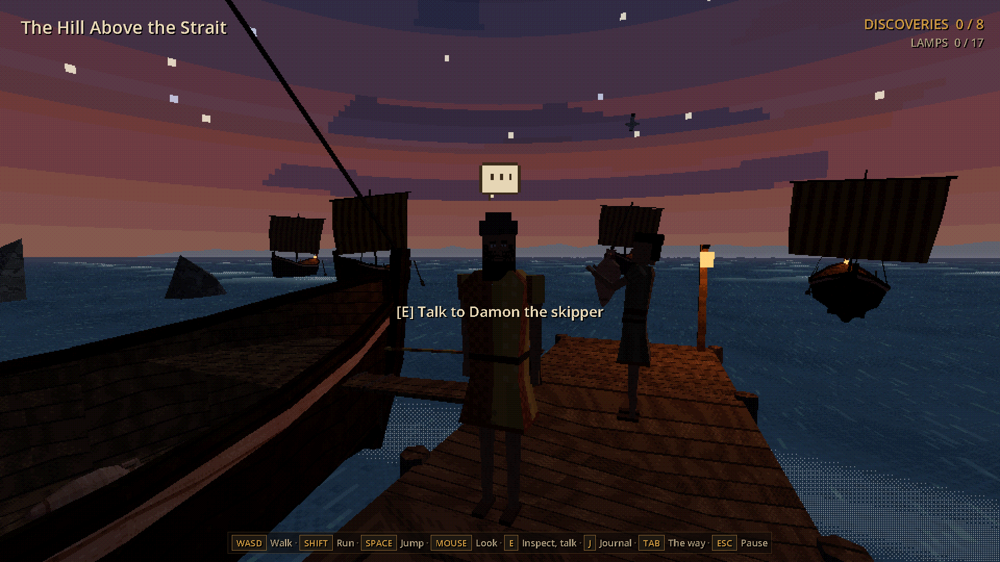
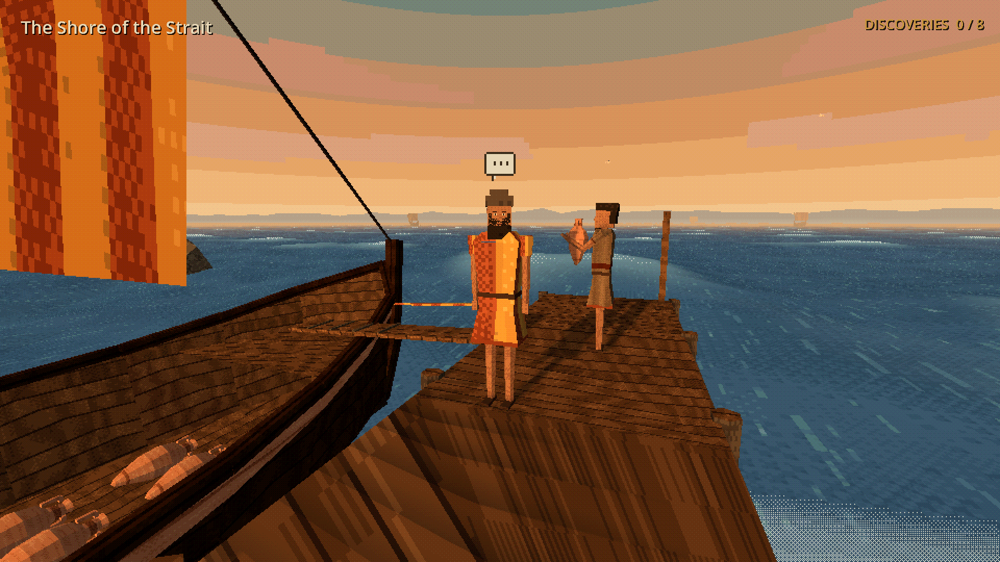
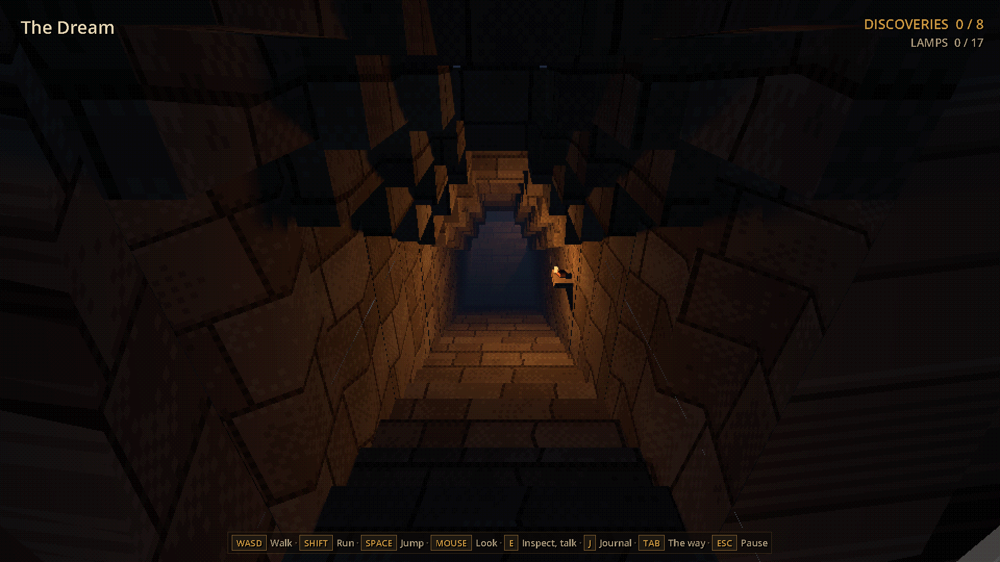
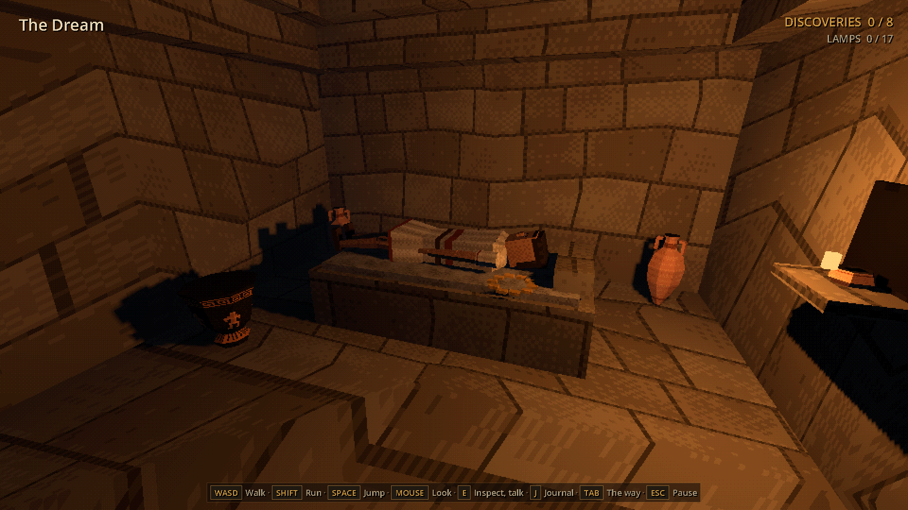

# Panticapaeum: Echoes of the Bosporus

**[Играть в браузере](https://stadytady.github.io/metridat-game/)** · **[Скачать v0.0.7](https://github.com/stadytady/metridat-game/releases/tag/v0.0.7)** (Windows, Linux) · **[Трейлер](docs/trailer.mp4)**

Поздний день, IV век до нашей эры. Вы стоите на холме над Киммерийским Боспором — проливом между Чёрным и Азовским морями. Внизу Пантикапей: черепичные крыши, ступенчатые улицы, площадь, святилище на террасе. По проливу идут корабли с зерном. Дальний берег тонет в дымке.

Это прогулка от первого лица по городу, которого больше нет, в манере игр для первой PlayStation: низкое разрешение, дрожащие полигоны, дизеринг, туман. Здесь не надо ни с кем сражаться и не нужно торопиться. Надо смотреть, находить вещи и слушать людей, а когда стемнеет — зажечь огни на обратном пути.


## О чём игра

Пантикапей основали выходцы из Милета на рубеже VII–VI веков до н. э. на горе, которую сегодня называют Митридат, — это нынешняя Керчь. В IV веке город был столицей Боспорского царства. Здешнее зерно кормило Афины, а афинские вазы и вино плыли обратно. Об этом мире почти всё известно по вещам из земли: черепкам, клеймам на амфорах, монетам, надписям.

Игра построена так же. Четырнадцать находок разбросаны по городу — от холма и парка до дома Мирто и пристани. Каждая открывает три страницы:

- что это за предмет;
- что о таких вещах известно историкам, со ссылками на источники;
- маленькую выдуманную историю — и она прямо так и подписана.

С каждой находкой день клонится к вечеру. На десятый из четырнадцати уже темнеет, и город зажигает свой свет: лампы у дверей, жаровни и лампы у колонн стои, окна домов, фонарь на краю пристани (порог `DayCycle.LAMPS_ON`, один на всех). солнце садится, небо краснеет, корабли с пролива подходят к берегу и встают на якорь, затем приходят звёзды и луна, а на кормах зажигаются фонари. Последняя находка приносит ночь. Тогда остаётся одно: вернуться на холм, зажигая по дороге светильники.

## Прогулка

Неспешный проход — примерно четверть часа, а можно бродить сколько угодно. Загрузок нет: это одна непрерывная сцена.

**Пролог.** Всё начинается накануне, в море. После стартового экрана «Ласточка» идёт по проливу к городу на закате. Сначала её видно с воды, со стороны, потом — с носа: впереди гавань, корабли на якоре с огнями и город на горе. Внизу экрана идёт легенда: о корове Ио, переплывшей пролив, отчего он и зовётся Боспором — Коровьим бродом; о милетянах, поставивших город на горе; о хлебе, рыбе и степном золоте; и о том, кому этот город снился раньше, чем он его увидел. Плавание длится 24 секунды, E, пробел или Esc его пропускают. Затем затемнение, и вы сходите на пристань: закат, в окнах загораются лампы, на мачтах кораблей огни. Кормчий Дамон говорит, что дальше корабль не идёт, и можно спросить его о снах, которые вас сюда привели, и о городе. Чем бы ни кончился разговор, он скажет, где спать и куда идти: «Ночуй на корме, под парусом не дует. А утром поднимись на холм, осмотри город». Экран темнеет, и вы на палубе «Ласточки» ночью: за кормой спящий город под звёздами и храм на высоте. Снова темнота, тот же вид на рассвете — «На рассвете — наверх, на холм», — и камера сходит с корабля, идёт по пристани, через пляж и проход в парапете, по агоре и вверх по лестницам улицы на холм, а там оборачивается к городу и становится вашими глазами: отсюда начинается прогулка. Ночь и подъём длятся около 22 секунд; E, пробел или Esc их пропускают. Esc в разговоре сразу ведёт к ночи.

**Холм над проливом.** Мощёная терраса, разрушенный парапет, упавшие барабаны колонн. Две уцелевшие колонны обрамляют вид на город и море. В западной половине террасы — маленький театр: три низких яруса каменных сидений полукругом над орхестрой, с видом на пролив. Рядом стоит деревянный стенд с масками, трагическими и комическими, а в орхестре репетирует актёр Федр — играет смерть царя перед пустыми рядами. Время от времени он уходит и садится на край нижнего ряда, подперев подбородок рукой, будто смотрит, как эту роль играет кто-то другой; если подойти, он не встаёт, а только поворачивает голову. По склонам вокруг террасы растут кусты олив. На запад, за парапет, открывается степь: сухая золотая трава до дымки, курганы с каменными бабами, длинные гребни на горизонте — и отара овец в загоне под террасой, которая пасётся, бродит и изредка блеет. Отсюда начинается спуск.

**Улица кувшинов.** Узкая ступенчатая улица между домами на каменном цоколе. Стены оштукатурены, у дверей стоят амфоры. В первом же дворе среди пифосов копошатся куры — и лежит амфора с клеймом. Город обжит и стоит так, как стоял Пантикапей: склоны изрезаны террасами на подпорных стенах, вдоль каждой террасы по склону вьётся улица с домами по обе стороны, а вниз между террасами сбегают крутые переулки-лестницы; над крышами днём из глиняных дымников и дымовых отверстий поднимается дым очагов, а с сумерками в окнах загораются масляные лампы — огонь в каждом окне дышит и вздрагивает сам по себе: на мостовой валяются черепки разбитого горшка, у стены забыта корзина, на паре крыш не хватает черепиц, во дворе на верёвке сохнет ткань. На перекрёстках, где переулок-лестница сбегает с террасы, стоят гермы — каменные столбы с головой и плечами; двери в домах то заперты, то стоят приоткрытыми: створка выставлена наружу, в переулок, а за ней темнота, и порог выложен камнем. У стен расставлено то, что не занесли в дом, — у каждого второго дома: пифос, корзина, поленница, амфора, ручная мельница, скамья, ряд кувшинов с кувшинчиком впереди, бельё на верёвке между двумя шестами. Окна — с каменным подоконником и деревянными ставнями, одна створка притворена, другая откинута к стене. За стенами слышно, что в домах живут: то стукнет молоток о наковальню, то заходит ткацкий станок, то заплачет ребёнок, то брехнёт дворовая собака, то женщина негромко поёт над работой. Каждый голос — у своего дома и со своим ритмом; с сумерками работа и песня стихают, а собака и ребёнок — нет. По самим улицам нет-нет да кто-то идёт: по террасам вверх и вниз, мимо дверей и гермов, шагом по земле — ступени и уклон он берёт ногами, а не скользит над ними. Иная работа вынесена из дома на порог, рядом с дверью, а не на её ступенях: у стены стоит ткацкий станок с натянутой основой, перед ним на низком табурете сидит женщина и бьёт по утку; в другом переулке мужчина плетёт корзину, поставив её между колен; женщина на коленях мелет зерно на зернотёрке; старик сидит на скамье у стены; две соседки стоят у двери и разговаривают; на крыльце сидит мальчишка и смотрит на улицу. По террасам ходят соседи по своим делам: женщины с гидрией или корзиной на голове, мужчины с амфорой в руках, медленный старик, бегущий мальчишка. С темнотой переулки не гаснут совсем: у иной двери на штукатурке висит на кронштейне глиняная лампа, и её свет лежит на стене и на камнях — идёшь ночью от одного пятна света до другого, а окна по террасам горят своими огоньками. И вода в переулке своя: там, где дома расходятся, стоит колодец с воротом и журавлём — каменный сруб, две стойки, перекладина с блоком и верёвка в тёмный зев; у сруба женщина в длинном хитоне перебирает верёвку, рядом ждёт гидрия, а камни у воды потемнели от пролитого. Живность и тут своя: у герма на перекрёстке спит дворовый пёс, а у колодца копошатся куры с петухом — те самые, что к ночи садятся на насест. С темнотой переулки меняются: работу уносят в дом (станок и корзина остаются стоять пустыми), прохожих на улицах вдвое меньше, а по улице у перекрёстка начинает ходить сторож с закрытым фонарём в руке: роговые стенки, бронзовая крышка, и свет падает только под ноги — пятно плывёт с ним по камням, а стены и небо над ним остаются тёмными; дворовые собаки за стенами брешут чаще, чем днём. Над городом в это время не спит стена: на каждой башне стоит часовой с копьём, рядом на крыше горит жаровня, и время от времени пост у акрополя поднимает факел, а остальные отвечают ему по очереди вдоль обеих стен, ближние раньше дальних. Раз в три переклички кто-то на своей очереди молчит — первый пост зовёт ещё раз, и проспавший отвечает с опозданием.

**Агора.** Главная площадь: стоя с дорическими колоннами — с капителей свисают ленты, а между двумя колоннами на жерди висит красное полотнище; верх привязан, низ ветер выдувает на площадь, и по подолу бежит рябь. Прилавок под тканевым навесом, постамент, с которого давно сняли бронзовую статую. В юго-западном углу — мастерская гончара Каллия. Он сидит за кругом, мальчик-подмастерье крутит круг рукой, рядом дымит печь. За печью сложены дрова, у колоды для рубки рассыпана щепа. Время от времени мальчик бросает круг, идёт вдоль мастерской за печь, набирает охапку поленьев, несёт её к устью, встаёт на колени и подкидывает дрова в огонь, а потом возвращается к кругу. Пока его нет, круг сам выбегает и останавливается. Перед мастерской гуляет петух со своими курами. У торца стои спит большая собака, изредка дёргая ухом. Там, где улица входит на агору, она расширяется в мощёную площадь во всю ширину агоры, вровень и с улицей, и с агорой. На площади колодец под деревянной рамой со шкивом: женщина перебирает верёвку, рядом ждёт гидрия. Набрав воды, она ставит гидрию на голову, придерживая её рукой, как на вазах с водоносами у фонтанов, обходит колодец и несёт воду к большому пифосу у скамьи под стоей. Там выливает её и возвращается с пустой гидрией на голове. У стены каменная скамья. По другую сторону улицы на своей земле просторный загон: мул бродит в нём от пучка к пучку травы, а у ворот копаются три курицы, опустив голову, жуёт, а время от времени идёт пить к деревянной лохани у ворот; в глубине кормушка с сеном, в углу олива для тени. Посреди площади клюют голуби — подойдёте, и стайка вспорхнёт на край крыши стои, а минуты через две-три по одному вернётся вниз. Камень у входа на площадь стёрт до светлого тысячами ног. Подойдёте слишком близко — с криком разбегутся. На мостовой между стоей и постаментом двое ребятишек играют в астрагалы: сидят друг против друга, один собирает с камней четыре костяшки, подкидывает их с ладони, и они ложатся между ним и товарищем, а тот, пока кости лежат, собирает их для своего броска. С ними можно сыграть: нажмёшь E — сядешь к ним третьим. Над столом видно, как кости вылетают из руки, кувыркаются и ложатся на плиту. Бросают по четыре кости, три раза; бьёт «бросок Афродиты», когда все четыре грани разные, «собака» — четыре единицы — проигрывает всему, иначе берёт кон тот, у кого сумма больше. Кости стучат о камень — сухой щелчок, а не стук игральной кости: у астрагала четыре грани, и считают их 1, 3, 4 и 6 — без двойки и пятёрки. Когда в городе зажигают фонари, дети собирают кости и уходят по тропинке в дом Мирто: на ночь они сидят в жилой комнате у очага.

**Домик у моря.** Самый восточный дом на правой руке, когда спускаешься к воде, — у городской стены. Дверь открыта: внутри ровный земляной пол, потолок, скамья и полка с лампой. У стены стоит хозяйка — платок, красный хитон до пола — и прядёт: в левой руке прялка с куделью у плеча, с правой на нити висит веретено. Оно крутится и понемногу опускается, пока тянется пряжа, а потом хозяйка сматывает нить, и всё начинается заново. Справа от двери на кронштейне висит глиняная лампа, и в сумерках она загорается вместе с остальным городом.

**Дом Мирто.** Через проход в южном парапете агоры тропинка ведёт к дому, в который можно войти. Во дворе на коленях у глиняной печи-тануру Мирто печёт лепёшки: хлопает тесто тонко и лепит его на горячую стенку. Когда лепёшка готова, она встаёт с ней и кладёт её на стопку на доске за спиной. Стопка растёт, пока домашние не заберут хлеб, а Мирто снова опускается к печи. За работой она не останавливается, а только поворачивает голову к гостю. С ней можно поговорить. Под навесом две комнаты: в одной — очаг, ложе с овчиной, полка с горшками и чернолаковый светильник на табурете, в другой — вертикальный ткацкий станок с глиняными грузилами на нитях основы, запасные грузила горкой на полу, корзина шерсти и светильник. Во дворе у западной стены, подальше от печи, клюют две курицы.

**Пляж.** Через проём в восточном парапете тропа спускается к морю. Над берегом и стоянкой кораблей кружат чайки. На песке лежит вытащенная лодка, на перекладине между двумя кольями сохнет переброшенная сеть, горит костёр. Рыбак Главк сидит на камне и потрошит утренний улов на доске: минуту с лишним над одной рыбой — надрезать, выскоблить, отбросить потроха, — потом кладёт её в плоскую корзину к остальным, встаёт, берёт из корзины у лодки новую и садится опять. Он охотно расскажет, как зимой пролив замерзает так, что по льду ездят повозки, — а напоследок посоветует не задерживаться на берегу после темноты. Южнее по пляжу, метрах в пятидесяти от корабля, держатся бакланы: одни бродят вперевалку по песку и чистят перья, другие стоят на камнях с раскрытыми крыльями — сушат их после рыбалки, изредка встряхивая. Чуть севернее в пролив уходит деревянная пристань, «Ласточка» привязана к её кнехтам провисшими швартовами, которые ходят вместе с кораблём на волне; у её северного края на настиле лежит свинцовый шток якоря. У неё под парусом стоит торговый корабль «Ласточка»: один моряк носит амфоры с настила на борт — берёт из штабеля, обходит кормчего, поднимается по сходням и передаёт через фальшборт, — другой сидит на краю настила и сращивает канат, а кормчий Дамон рассказывает, чего ночью лучше не видеть. Вечером на конце пристани зажигают фонарь.

**Святилище Гекаты.** У нижних ворот, где дорога с агоры встречает лестницу, стоят миски с хлебом и лепёшками — «ужин Гекаты», богини перекрёстков и ночи. Лестница между кипарисами поднимается на террасу. Наверху чаша с водой — омыть руки. Храм стоит на трёх ступенях, двери открыты, и в глубине при свете лампы видна трёхликая Геката с факелами. Перед храмом алтарь с огнём и венками, бронзовый треножник, полка с глиняными статуэтками. Вдоль западной ограды под навесом лежат овечьи шкуры: сюда приходят спать ради снов. В сумерках огонь алтаря видно издалека, ночью у дверей храма горят два факела.

**Ночь.** Вдоль пути стоят 17 бронзовых светильников с масляными лампами и факелы. Их можно зажечь. Ночью город меняется. У входа на агору горит лампа у «ужина Гекаты». Собака у стои просыпается и смотрит в сторону святилища, а где-то за ним воют псы. В глубине улицы стоит фигура в чёрной тоге с глубоким капюшоном, под которым нет лица, — и, когда подходишь, рассыпается по пикселям и исчезает. Над проливом, дальше стоящих на якоре кораблей, бродит бледный огонёк — тот самый, о котором предупреждал рыбак. Его рыба так и лежит на камне у воды. Когда путь освещён, остаётся вернуться в святилище Гекаты и лечь на свободную шкуру в абатоне.

**Сон.** Тропа из камней, вдоль неё кусты олив и мёртвые деревья, уходит в густой ночной туман, луна светит ярче обычного, звуки города стихают — остаются низкий гул и где-то впереди вой собаки, животного Гекаты. Впереди на тропе стоит кто-то в чёрном капюшоне — и, когда подходишь, рассыпается и исчезает. Трижды. В конце тропы курган с каменным порталом и алтарь перед ним, а на алтаре у маленькой масляной лампы стоит бронзовое зеркало. Стоит в него заглянуть — и в тишине со скрипом отворяются двери кургана. За ними длинная лестница уходит под землю, под ступенчатый свод: каждый ряд камней выступает над нижним, пока ряды не сойдутся. На полпути на уступе горит лампа. Внизу — квадратная погребальная камера с таким же ступенчатым куполом, амфоры по углам, кратер, лампа в нише. На каменном ложе под овчиной спит человек — так же, как ты лёг в абатоне, у головы золотой венок. Склонишься над ним — КОНЕЦ, титры, и можно проснуться в абатоне и гулять дальше ночным городом.

Пятнадцатая находка — зеркало из сна: она не входит в счёт городских четырнадцати и появляется в журнале, только когда найдена.

Каждую найденную вещь можно рассмотреть: в панели находки она лежит крупно, медленно поворачивается, её можно покрутить мышью и приблизить колесом.

Потерялись? Клавиша **J** открывает журнал: найденное — с названием и местом (щелчок откроет его снова), ненайденное — с подсказкой, где искать.

Клавиша **Tab** открывает «Путь»: четыре задачи с полосками прогресса и восемь достижений — закрытые с условием, открытые с галочкой. Достижения выдаются сами: справа внизу выезжает карточка с кубком и коротким звоном.

| | |
|---|---|
|  |  |
|  |  |
|  |  |
|  |  |
|  |  |
|  |  |
|  |  |
|  |  |
|  |  |
|  |  |
|  |  |

## Правда и вымысел

Игра старается честно разделять одно и другое.

- В «Исторических данных» только то, что принято в литературе, и у каждой находки указаны источники: Геродот, Страбон, Демосфен, свод боспорских надписей (CIRB), работы Schefold, Boardman, Higgins, Højte, MacDonald и другие.
- Гончар Каллий, рыбак Главк, виноторговец Формион, текст стелы и святилище Гекаты на террасе придуманы. Сам культ Гекаты у греков реален, а посвящение этого святилища ей — вымысел игры. Они появляются только в разделах «История — вымысел» и в разговорах, а панель разговора помечена: «Вымышленный персонаж: слова — вымысел». Факты, на которые намекают персонажи, лежат в соседней находке с источниками.
- Архитектура вдохновлена греческими городами Северного Причерноморья: каменный цоколь и штукатурка, черепица, дорический ордер, без римских арок и куполов. Реальная топография Пантикапея и горы Митридат упрощена.
- Сон, тропа, фигура и курган с зеркалом — вымысел. Ночлег в святилище ради сна (инкубация) — реальный греческий обычай, известный по святилищам Асклепия и Амфиарая; для Пантикапея он не засвидетельствован. Боспорские курганы с каменными коридорами-дромосами реальны, этот — нет. Своды коридора и камеры сложены по их образцу: ступенчатый («ложный») свод из выступающих рядов камня и квадратная камера под таким же куполом, как в Царском кургане под Керчью (IV век до н. э.). Длинная лестница вглубь — вольность сна: в Царском кургане дромос лестницей под землю не уходит. Спящий двойник, двери и всё, что лежит в камере, — вымысел.
- Пролив сужен: при настоящей ширине противоположный берег не был бы виден сквозь туман.
- Уличного освещения у греков не было. Ряд огней вдоль дороги — игровая условность, но сами светильники, лампы и факелы — той эпохи.

## Как это выглядит

Так, как могла бы выглядеть игра 1999 года. Картинка рисуется в низком разрешении — 960×540 на экране 1080p (480 строк на 1440p, 360 на 720p, масштаб всегда целый) — и растягивается без сглаживания. Цвет 15-битный, с дизерингом. Вершины дрожат, привязанные к пиксельной сетке, текстуры «плывут» аффинно, вдали всё уходит в туман. Люди собраны из отдельных сегментов, как персонажи тех лет: шестигранные руки и ноги сужаются к кистям и стопам, у каждого нарисованное лицо 32×32, своя причёска, борода или без, хитон некрашеный или крашеный мареной, вайдой, охрой, с каймой и поясом; двигаются рывками, 15 кадров в секунду. Куры — из угловатых блоков. Всё это — ассеты, звуки и музыка трейлера — сделано кодом, без сторонних ресурсов. PS1-эффекты можно выключить в меню паузы.

Интерфейс на английском и русском, язык переключается в меню паузы на лету.

## Управление

Игра начинается со стартового экрана над видом с холма: щелчок, Enter, пробел или E — начать. Прицела на экране нет: когда взгляд упирается в то, что можно осмотреть, зажечь или с кем поговорить, внизу появляется подсказка «[E] …».

| Клавиша | Действие |
|---|---|
| WASD / стрелки | ходьба |
| Мышь | обзор |
| Shift | бег |
| Space | прыжок |
| E | осмотреть / поговорить / закрыть панель |
| Мышь в панели находки | тянуть — повернуть предмет, колесо — приблизить, двойной щелчок — сбросить вид |
| J | журнал находок: найденные — с названием и местом (щелчок — открыть снова), ненайденные — «? ? ?» и подсказка, где искать |
| Tab | «Путь»: задачи с полосками прогресса и достижения с условиями (←/→ — раздел) |
| Esc | пауза: чувствительность мыши, инверсия Y, вкл/выкл PS1-эффектов, язык **EN / RU**, выход |
| F3 | оверлей производительности: FPS, время кадра, draw calls, треугольники, VRAM, GPU |

Настройки хранятся в `user://settings.cfg`. Язык при первом запуске берётся из системы (русская система → RU, любая другая → EN), дальше — из меню паузы; переключение действует сразу, в том числе на открытую панель находки.

## Как запустить

- **В браузере:** https://stadytady.github.io/metridat-game/ (лендинг с трейлером, игра — по кнопке «Play in browser»). В вебе Godot использует Compatibility-рендер (WebGL 2), всё остальное то же.
- **Скачать:** [Releases](https://github.com/stadytady/metridat-game/releases): zip для Windows, tar.gz для Linux, web-сборка, трейлер, SHA256SUMS.
  - **Windows:** распаковать и запустить `Panticapaeum.exe`. Он не подписан, поэтому SmartScreen может показать «Система Windows защитила ваш компьютер»: «Подробнее» → «Выполнить в любом случае». Если игра не стартует — запустить `Panticapaeum.console.exe`, он покажет лог движка.
  - **Linux:** `tar xzf …` и `./panticapaeum.x86_64` (tar сохраняет бит исполнения; zip-артефакты Actions его теряли).

- Открыть `project.godot` в Godot **4.5.1** (стандартная сборка, не .NET) и нажать F5. Первый импорт ассетов занимает несколько секунд.
- Сборка под Windows: `tools/export.sh windows` создаёт `build/windows/Panticapaeum.exe` (один файл, pck внутри). Готовый .exe также есть в артефактах CI (`panticapaeum-windows-x86_64`).

---

## Для разработчиков

Godot 4.5.1, GDScript со статической типизацией, Forward+ (в браузере — Compatibility). Правила и инварианты для изменений — в [AGENTS.md](AGENTS.md).

### Трейлер

[`docs/trailer.mp4`](docs/trailer.mp4): 31 секунда, 1280×720 при 30 FPS, H.264 (CRF 20) + AAC, громкость ≈ −15 LUFS (однопроходный loudnorm), пик −1.5 dBFS. Версию 1080p даёт `SIZE=1920x1080 tools/trailer.sh out.mp4`. Снят в самой игре, без монтажа снаружи, но чисто: мир рисуется в полном разрешении кадра, без дизеринга, дрожания вершин и аффинных текстур (сами текстуры остаются низкими, 128 px). Трейлер в игровом PS1-виде (960×540), даёт `PSX=1 tools/trailer.sh out.mp4`. День уходит в ночь, как в игре: каждый план задаёт свой час суток, после заката горят все светильники. Камера идёт по сплайнам Catmull-Rom, плавно разгоняясь и тормозя, с лёгким «дыханием»; планы склеены секундными наплывами:

1. с крана над городом террасами, над крышами дым из дымников, к проливу; подпись «The Cimmerian Bosporus, 4th century BCE»;
2. театр на холме: с верхнего ряда мимо актёра, репетирующего перед пустыми сиденьями, к проливу;
3. по тропинке от агоры прямо в дверь дома и к Мирто у печи;
4. закат: вдоль пристани к «Ласточке», моряки и кормчий;
5. ночь: вверх по лестнице между зажжёнными светильниками, в окнах мерцают лампы, наверху стоит фигура в чёрном капюшоне;
6. храм Гекаты ночью: огонь алтаря, факелы, медленный наезд к открытым дверям, в глубине трёхликая Геката;
7. сон: вниз по лестнице кургана под ступенчатым сводом, к свету лампы в камере, где кто-то спит;
8. ночь на холме: между колоннами открываются город, корабли на якоре с фонарями и пролив, удар музыки, титр.

Планы длинные и медленные: каждое движение плавно разгоняется и тормозит, между планами секундные наплывы, «ручное» дрожание камеры едва заметно.

Каше 2.39:1 и титры рисуются внутри вьюпорта мира (разметка в единицах 640×360, масштабируется под его размер), поэтому в PS1-виде они пиксельные и с дизерингом, как всё остальное. Звук — окружение из игры (ветер, прибой, огонь, чайки, куры) плюс синтезированная тема по ходу дня: бурдон на D и щипковая лира Карплуса — Стронга в дорийском ладу днём, второй голос на закате, мягкий удар и октава ниже с наступлением ночи, затихание и дыхание во сне, низкий удар на раскрытии с холма.

```sh
tools/trailer.sh [out.mp4]   # Movie Maker (--write-movie, --fixed-fps 30) + ffmpeg; кадры точные на любом GPU
```

План съёмки — `scripts/core/trailer.gd` (`SHOTS`: время, позы камеры, FOV, подпись).

### Время суток и светильники

Время суток — одно число от 0 (поздний день, старт) до 1 (ночь), `DayCycle`. Каждая новая находка сдвигает вечер: солнце опускается, небо переходит от дневной панорамы к закатной и к ночной со звёздами и луной, туман и окружающий свет холодеют, море темнеет. Последняя находка приносит ночь (переход ~12 с).

Вдоль маршрута — 17 светильников: бронзовые подставки с глиняными масляными лампами на холме и улице, факелы у входа на агору, у лестницы к святилищу и у дверей храма Гекаты. **E** — зажечь; счётчик «СВЕТИЛЬНИКИ» появляется с закатом. Цель ночи — осветить обратный путь к холму. Честная оговорка: уличного освещения у греков не было; ряд огней — игровая условность, сами предметы (светильники, лампы, факелы) — той эпохи. Свои огни горят и без игрока: печь гончара и костёр рыбака.

### Звук

Всё, что звучит, синтезируется кодом: `tools/gen_assets.py`, 22 050 Гц моно, зацикленность — флаг в `.import`. Слои: ветер везде, прибой в четырёх точках вдоль берега, чайки с паузами, говор площади у агоры и редкий выкрик через неё, печь и костёр. Сон глушит городские слои; шаги остаются.

Цикады на холме — три источника в сухой траве у террасы и на западном склоне (`Ambience.CICADA_AT`): на холме их слышно, вниз по улице они истончаются. Они живут по часу суток: пока день жаркий — поют, к сумеркам стихают, к светильникам их нет совсем (`CICADA_FROM` = 0,42, `CICADA_TO` = 0,80), в сне молчат. Бед длиной 12 с: все частоты укладываются в целое число периодов на цикл, а шум фильтруется по кругу, поэтому стыка петли не слышно.

Шаги выбираются по поверхности: у коллайдера есть мета `surface` — `stone` у мощения, стен, настилов и палуб, `dirt` у рельефа. Если пол касается в двух местах (мостовая лежит над землёй, палуба над песком), звук берёт верхнее касание — то, на что встала нога. По камню — хлопок подошвы, короткая кромка, тело плиты и звон плиты (688–806 Гц); у каждого из четырёх вариантов своя частота звона, иначе все шаги звучат одним и тем же звуком. По земле — глухой удар с крупкой, тише на 3 дБ. Центр спектра: плита 1,6–2,2 кГц, земля 0,5–0,8 кГц; через 60–160 мс после удара плита ещё звенит (около 1600 переходов через ноль в секунду), а земля уже мертва (150–300). Обход считает и те, и другие шаги (`stone_steps`, `dirt_steps`) и падает, если шагов одного рода нет: без этого «звук по поверхности» можно сломать и не заметить.

### Стартовый экран, ввод

`scripts/ui/title_screen.gd`: название одним словом с разрядкой, как на каменной надписи, между двумя полосами непрерывного меандра (рисуется квадратными пикселями, узор проверяет `test_title.gd`), и кнопка START/НАЧАТЬ. Курсора нет, начать можно щелчком в любом месте или клавишей. Мир за экраном живёт, HUD скрыт. START захватывает мышь прямо из щелчка — так браузер разрешает pointer lock. В режимах автоматизации (`--shots`, `--walkthrough`, `--trailer`) экран не показывается; проход открывает его сам и проверяет, что START отдаёт игру.

Пролог — `scripts/core/prologue.gd` (`Prologue`). Сначала плавание (`_voyage()`). Корабль — тот же, что стоит у пристани: `Harbour.sail(pos, yaw)` уводит его в море, прячет сходни и качает на волнах свободнее, чем у причала, а `Harbour.moor()` возвращает на место. Поэтому двух «Ласточек» в кадре не бывает. Курс задаёт `Prologue.course_at(k)` — кривая Безье от открытого пролива к пристани с замедлением к концу; она проходит между кораблями на якоре, и тест держит её не ближе 18 м (с поправкой на масштаб корабля) к любому из них. Камера своя (`VoyageCamera`): до `BOW_FROM` она идёт рядом с кораблём с кормы, затем стоит над носом, выше борта. Строки легенды — `UI_LEGEND_1..4` по расписанию `Prologue.LEGEND`. Это пересказ мифа и предания, а не находка, и источников в игре у него нет: миф об Ио, переплывшей Боспор Киммерийский, — у Эсхила («Прометей прикованный»), основание Пантикапея выходцами из Милета — общепринятая версия. На время плавания `Game.ui_blocking` включён, HUD скрыт, клавиши только пропускают. После затемнения `main.gd` ставит игрока на настил пристани (`Prologue.arrival_point()`, с береговой стороны от кормчего) и включает `Game.prologue`: `Game.time_target()` отдаёт `DayCycle.PROLOGUE` (0,82, сумерки), атмосфера встаёт сразу по сигналу `prologue_changed`, без перехода. Разговор — `data/dialogues/prologue.dialogue` голосом Дамона через ту же `DialoguePanel` (`open(npc, resource, start, counts = false)`): он не засчитывается как разговор с Дамоном, ни в квест, ни в достижения. Панель по закрытию шлёт `closed`; дальше `Prologue.morning()`. Свой час у пролога один — `Game.prologue_hour`: сумерки на пристани, `NIGHT_HOUR` на корме и `DAWN_HOUR` на рассвете; в прологе атмосфера переключает часы скачком, за затемнением. Камера (`NightCamera`) стоит на палубе (`STERN_EYE`, в системе корабля) и смотрит за корму на город (`NIGHT_LOOK`); подписи `UI_PROLOGUE_NIGHT` и `UI_PROLOGUE_DAWN` идут строкой легенды. Подъём — ломаная `Prologue.ascent_points()`: пристань, пляж, проход в парапете, агора и улица по её изгибам через каждые 4 м, на `CLIMB_EYE` над `Topo.surface`; камера идёт по ней с ровной скоростью (`ascent_at` — по длине пути, со смягчением на концах), смотрит на `LOOK_AHEAD` вперёд, а на последних `TURN` поворачивается во взгляд игрока, уже поставленного на `Topo.spawn_point()`. Нажатия в первые `SKIP_GUARD` секунды после разговора пропуском не считаются: это ещё клавиша, закрывшая разговор. В режимах автоматизации пролог сам не запускается; проход запускает его сразу после стартового экрана и проверяет. Кадры плавания, ночи и подъёма: `tools/shots.sh DIR --only=voyage` (`voyage_02` … `voyage_23`, `voyage_pier`, `night_stern`, `night_dawn`, `night_climb_03` … `night_climb_98`, `night_hill`).

После закрытия любой панели (находка, разговор, журнал, стартовый экран) клавиша E 0,4 с не действует на мир (`Game.can_interact_now`): иначе то же или следующее нажатие снова открывало находку, и из неё нельзя было выйти. Проход проверяет это на каждой находке; без задержки проверка падает.

### Осмотр находок

Панель находки: слева `ItemViewer` — отдельный маленький 3D-мир (`own_world_3d`) с одной моделью, своим постоянным светом (время суток туда не доходит, ночью находку видно) и той же PS1-картинкой: рендер 300×300, растяжение nearest, `psx_post` с 15-битным цветом и дизерингом. Модель находки лежит в `Discovery.model` (её же ставит на карту `Inspectable`). Камера подбирается по габаритам модели (`ItemViewer.fit_distance`), плоские вещи показываются сверху (`rest_pitch`). Предмет вращается сам; тянуть мышью — повернуть, колесо — приблизить, двойной щелчок — сбросить. Пока панель открыта, курсор свободен, а витрина рендерится только в это время. Найденное можно открыть снова из журнала. Кадры всех находок в витрине: `tools/shots.sh DIR --only=finds`. Проверено и на Forward+ (lavapipe), и на Compatibility (OpenGL, как в браузере).

### Сон

`scripts/world/dream.gd` — отдельная небольшая зона далеко за картой (`ORIGIN`), её из города не видно за туманом. Шкура в абатоне (`SleepSpot`) работает, только когда горят все светильники; иначе подсказка «ещё не время». Вход и выход — за затемнением; время суток прыгает в `DayCycle.DREAM` (1.25: туман 1,5–24 м и закрывает небо, яркая луна) и обратно, атмосфера в эти моменты не плывёт, а встаёт сразу. Звуки города (ветер, прибой, чайки) приглушаются. Три фигуры на тропе — сегментные `Figure` без коллайдера, ближе 9 м рассыпаются и исчезают. Их, как и ночную фигуру на улице, собирает `Figure.shrouded()`: чёрная тога до земли, накидка на плечах, широкие рукава закрывают руки, капюшон, а под ним вместо лица чернота (материал `void`). Исчезает фигура через `Apparition`: шейдер `psx_ghost` отбрасывает пиксели экрана по шуму с порогом `fade` (на каждый экземпляр), за 1,6 с, шагами по 15 кадров/с. Это отсечение, а не полупрозрачность, как у `psx_cutout`. Зеркало — находка эпилога (`Discovery.epilogue`): не входит в `Game.total()`, не двигает вечер, в журнале только после находки. После осмотра открываются двери кургана (`open_doors`: две створки на петлях, `door_open_at` — 3 с, шагами по 15 кадров/с, звук `door_creak`), коллайдер в проёме снимается. Курган полый: насыпь собрана своим «токарным» мешем на 56 секторов, два нижних сектора напротив портала вырезаны (`mound_cut`), их закрывают каменные стены коридора. Лестница — 22 ступени по 0,2 м, под ногами наклонная плоскость по рёбрам ступеней (`tomb_floor`); свод спускается уступами по две ступени, с замковым камнем в вершине. Всё подземное — на своём слое отрисовки (`Atmosphere.UNDERGROUND`): солнце и луна туда не светят, только две лампы с тенями; глубже стены темнее (цвет вершин). На ложе — `TombSleeper` (поза `sleep` с дыханием, подсказка «[E] Склониться»); после него — `end_screen.gd`: КОНЕЦ, титры, Enter — проснуться в абатоне, Esc — выйти. При новом сне двери снова закрыты.

### Люди, разговоры, журнал

Люди собраны из жёстких сегментов, по одному боксу на часть тела (`Figure`), как персонажи на PS1. Анимация процедурная и квантована до 15 кадров/с. Позы: стоя, гончар за кругом, подмастерье на корточках, рыбак за разделкой рыбы. С гончаром и рыбаком можно поговорить: **E** — следующая реплика, **Esc** — уйти. Голова собеседника поворачивается к игроку, если тот ближе 5 м. Панель разговора помечена «Вымышленный персонаж: слова — вымысел». Исторические факты — в находках рядом («Форма для статуэток», «Глиняные грузила»), с источниками.

Механика взаимодействия общая: всё, что имеет `interact()` и `get_prompt()` (находки, светильники, NPC), подхватывается лучом `Interactor`.

**J** открывает журнал: все находки в порядке маршрута. Найденная — с названием и местом, ненайденная — «? ? ? ещё не найдено» и подсказка, где искать (не точка на карте, а ориентир: «во дворе среди пифосов и кур», «через ворота и вверх по лестнице»). Подсказки — ключи `D_<ID>_HINT`, у каждой находки обязательны на обоих языках.

### Поручения

Четверо просят о помощи в разговоре: Мирто потеряла грузик от станка, водоноска Агата — светильник, который сын унёс играть к колодцу, рыбак Главк — бронзовый крючок, оброненный за лодкой со стороны моря (со стоянки его не видно), подмастерье — астрагал на ступенях стои. Просьба — отдельный выбор в диалоге (`- LOC_Q_*_ASK [if Game.quest_offered(id)]`), он исчезает, как только поручение взято. Потерянная вещь до этого не лежит на карте; после — лежит под ромбом-маркером, **E** подбирает. В следующем разговоре человек благодарит, и поручение закрыто. Наград пока нет.

Состояние — `Quests.NONE → TAKEN → FOUND → DONE`, переход — чистая функция `Quests.next_state` (шаги не по порядку ничего не меняют). Список — `Quests.LIST`: кто даёт, заголовок, название вещи, её модель (`Props`) и ключ выбора. Вещь — `QuestItem`: только на слое луча (слой 2), игрок о неё не спотыкается, а пока она скрыта, коллайдер выключен и не перехватывает луч у находки за ней. Взятые поручения видны на «Пути» (**Tab**) отдельным списком, смена состояния — короткой надписью, как название места. Бот в проходе берёт, находит и отдаёт все четыре; разговоры с подмастерьем и водоноской теперь входят в «все разговоры».

### Локализация

Все тексты — по ключам через `TranslationServer`. Источник один: [`data/i18n/strings.csv`](data/i18n/strings.csv) (`keys,en,ru`, удобно править в табличном редакторе). Godot импортирует его в `strings.en.translation` / `strings.ru.translation` (коммитятся: `project.godot` на них ссылается). Ключи: `UI_*` — интерфейс, `LOC_*` — названия мест, `D_<ID>_*` — тексты находок и подсказки журнала, `NPC_*` — имена и реплики; в `data/discoveries/*.tres` лежат ключи, а не тексты. Библиография (`sources`) не переводится. Трейлер и лендинг — на английском.

`test_i18n.gd` проверяет: каждый ключ из кода и данных есть в CSV; у каждой строки оба языка, русский — кириллицей; плейсхолдеры (`%s`, `%d`) совпадают; импортированные переводы равны CSV. Проход (`--walkthrough`) переключает язык при открытой панели находки и проверяет, что панель и HUD перерисовались.

### Достижения и «Путь»

Восемь целей: первая находка, все находки, все светильники, все разговоры, сон, тихий проход до сна (не поговорив ни с кем), второй разговор с Федром и минута ночи в городе. Прогресс считается чистыми функциями (`Achievements.satisfied`, `silent_earned`, `again_earned`, `night_earned`) и выдаётся по событиям, а не в `_process`.

id достижения — это же имя API в Steamworks (`ACH_FIRST_FIND`), поэтому Steam-сборке достаточно выставить `Achievements.backend` — объект с `unlock_achievement(id)`. Прямых вызовов Steam в игре нет, так что Windows, web и тесты работают одинаково. Сохранение — `user://achievements.cfg`, отдельно от настроек.

Карточка выезжает справа внизу с нарисованным кубком и коротким звоном, на своём canvas-слое поверх панелей: панель находки иначе её закрывает. **Tab** открывает «Путь» — задачи с полосками и список достижений с условиями.

### Надписи

Имя города на стартовом экране — **ΠΑΝΤΙΚΑΠΑΙΟΝ**, нарисованное штрихами: `GreekType` хранит глифы как полилинии в единичном боксе (тонкие линии, острые углы, широкие формы), `GreekTitle` центрует слово и подгоняет кегль под окно. Файла шрифта нет — и не нужно: глифы это данные, поэтому они резкие на любом размере и не тянут лицензию. Шаг у каждой буквы свой (`advance()` по её реальной ширине плюс боковой просвет), иначе узкая йота встаёт на широкую базу и слово разъезжается.

Нужна новая надпись — добавь глифы в `GreekType.GLYPHS` и вызови `GreekType.draw()`. `missing()` возвращает буквы без глифа, и `test_greek_type` падает, если в слове такая есть, если штрих вылез из бокса или если буква без штрихов.

### Дома, в которые можно войти

Обычный дом улицы — **сплошной блок** с коллайдером: войти в него нельзя. Вход даёт `Arch.cottage()`: стена двумя кусками с проёмом (1.15 × 2.05 м), перемычка над ним, ровный пол, потолок, скамья и полка внутри, ступени от порога к земле (дом садится на самую высокую точку участка, и без ступеней на склоне не войти). Коллайдеры — у стен, пола и ступеней.

Так собран домик у моря: `Backdrop._pick_cottage()` берёт самый восточный дом на стороне +z, чтобы это всегда был один и тот же дом, как бы город ни разрастался. Ночью его фонарь зажигает `Backdrop._process` по `WallLamp.DUSK`, а проход проверяет, что все настенные лампы (группа `wall_lamp`) к ночи горят.

### Парк на склонах холма

Не клумба на террасе, а парк: по обе стороны от театра склоны холма разбиты на рощу. С каждой стороны — длинная каменная дорожка (25 м, от калитки в парапете до бровки над крышами), две поперечные и внешняя дорожка, которая замыкает их в кольцо по ровной вершине холма. Между ними девять рядов олив в шахматном порядке, так что каждое крыло — роща примерно 25 × 30 м: 80 олив на обе стороны и 12 кипарисов. Кипарисы стоят парами у дорожки от калитки и за богиней.

У дорожки от северной калитки на соломе лежит мраморная голова богини в шлеме — находка: она повторяет настоящую голову из колодца у дворца на акрополе. Мраморная богиня закрывает длинную дорожку с запада и смотрит вдоль неё на море — её видно от самой бровки. Вдоль дорожки стоят бронзовые юноши, против каждого — скамья. В концах поперечных дорожек, за внешней, — гермы. Деревья сажаются по рядам, но место пропускается, если оно ближе 1 м к краю дорожки, ближе 2,4 м к фигуре или 1,9 м к скамье. В прошлой версии ряды сажались вслепую, и кроны росли прямо сквозь статуи и скамьи.

В калитки (по одной на север и юг, `Park.GATE_X`) спускаются три ступени — земля снаружи платформы на метр ниже её пола; проём в парапете вырезан из тех же сегментов, что строит `hilltop.gd`, так что остальной парапет не сдвинулся ни на сантиметр (генератор случайных чисел тот же, пропускается только постройка).

Роща — **один меш**: полсотни деревьев отдельными узлами стоили бы больше отрисовок, чем весь город. Поэтому `Props.olive_tree(kit, seed, xf)` принимает трансформацию и пишет в общий `MeshKit`.

Фигуры опираются на одну настоящую находку: в засыпи дворцового колодца на акрополе Пантикапея нашли мраморную голову женского божества от статуи высотой не менее 2,5 м (середина IV в. до н. э., школа Поликлета); позже металлический венец заменили каменным коринфским шлемом, и статуя стала Афиной — покровительницей царского дома ([ГМИИ им. А.С. Пушкина, «Пантикапей — столица Киммерийского Боспора»](https://www.arts-museum.ru/museum/articles/pantikapey/index.php?page=3)). Остальные фигуры — обычная городская скульптура: вымысел, как и всё на этой карте.

Тесты (`test_park`):
- роща — не меньше 76 олив, не меньше 8 м в обе стороны от калитки и не меньше 36 м от оси;
- дорожки лежат на земле (±5 см) и не круче 0,5;
- калитка начинается у самого парапета;
- ни одно дерево, кипарис или фигура не стоят на дорожке;
- ни одна олива не ближе 2 м к фигуре и не ближе 1,5 м к скамье;
- каждая фигура смотрит на дорожку;
- дерево не растёт в степи и не на террасе.


### Отладочное меню

Клавиша **`~`** открывает меню разработчика: две страницы. «Время» — фиксированные часы (утро, полдень, закат, сумерки, ночь, глубокая ночь, час сна) и «обычный ход», который возвращает час находкам. «Места» — все точки обзора из `World.viewpoints()`: выбор и `E` переносят туда камеру сразу.

Третья страница — «Сцена»: лечь в абатоне (переносит на шкуру, зажигает все светильники и запускает сон), войти в сон сразу, проснуться и зажечь все светильники. Это те же вызовы, что у игрока: `Game.dream_requested` и `Dream.wake()`, а не отдельная ветка сна.

Меню намеренно нет в легенде клавиш: игроку оно не нужно. Новая точка обзора попадает в список сама, как только её добавили в `World.viewpoints()`, — отдельный список в панели не ведётся.
### PS1-конвейер

| Приём | Где |
|---|---|
| 3D рендерится в `SubViewport` около 480 строк: 960×540 (shrink 2 при 1080p, всегда целое; `INTERNAL_HEIGHT`) и растягивается nearest-фильтром | `scenes/main.tscn`, `scripts/core/main.gd` |
| 15-битный цвет (31 уровень на канал) с упорядоченным дизерингом Bayer 4×4 в низком разрешении | `assets/shaders/psx_post.gdshader` |
| Вершины привязаны к сетке низкого разрешения (дрожание полигонов) | все `assets/shaders/psx_*.gdshader`, глобальный `psx_resolution` |
| Аффинное текстурирование, с ослаблением на рельефе и мощении | `psx_lit.gdshader`, `affine_amount` в материалах |
| Большие полигоны режутся на ячейки ≤ 3 м, иначе аффинное искажение «плавит» плиты (так делали и на PS1) | `MeshKit.max_edge` |
| Текстуры 64×64 и 128×64, палитра 5–8 цветов на текстуру, ordered dither, nearest, без мипмапов | `tools/gen_assets.py` |
| Flat shading, Lambert без бликов, тени с жёстким фильтром (в низком разрешении они получаются ступенчатыми) | `MeshKit`, `atmosphere.gd` |
| Линейный depth fog: море уходит в дымку горизонта | `atmosphere.gd` |
| Море: сетка 4 м у берега и крупнее к горизонту; 4 направленные волны с дисперсией глубокой воды и обмелением у берега; плоские грани ловят солнце; барашки и полосы прибоя к реальной линии берега (`Topo.waterline_x`), края пены дизерингом | `psx_water.gdshader`, `sea.gd` |
| Небо — расписная панорама полосами без фильтрации | `sky.png`, `PanoramaSkyMaterial.filter = false` |
| Лампы в окнах: свой шейдер мерцания, у каждого окна своя фаза в альфе вершин, шаг 15 кадров/с | `psx_lamp.gdshader`, `Arch.lamp_phase` |
| Фигуры-призраки растворяются без полупрозрачности: пиксели отбрасываются по шуму с порогом `fade`, шаг 15 кадров/с | `psx_ghost.gdshader`, `Apparition` |
| Огонь — квадратные частицы с 15 FPS | `scenes/environment/altar_fire.tscn` |
| UI в нативном разрешении: плоские панели с жёсткой рамкой, шрифт без сглаживания | `scripts/ui/` |

PS1-эффекты отключаются в меню паузы: это удобно для сравнения и при проблемах с читаемостью.

### Ассеты

Все ассеты оригинальные и генерируются кодом. Сторонних ассетов и Blender нет.

- `tools/gen_assets.py` (numpy + Pillow): 41 текстура, 71 материал `.tres` (включая `psx_cutout` для сетей), 29 звуков (ветер, прибой, три крика чайки, восемь шагов по камню и земле, треск огня, кудахтанье и тревожный крик кур, тема трейлера). У каждого нового ассета свой seed: добавление не меняет уже закоммиченные файлы. Петли бесшовные (FFT-фильтрация кольцевая), зацикливание задаётся в `.import`.
- `tools/bake_models.gd`: запекает пропсы из `Props` в **GLB** (`assets/models/`) — амфора, пифос, кратер, дорическая колонна, олива, кипарис, корабль, треножник, статуэтка. Игра грузит именно GLB, а `Mats.apply_to` по имени материала glTF подставляет PSX-шейдеры.
- `tools/build_assets.sh` пересобирает всё по порядку. Результат коммитится.

Мелкие одноразовые модели (лодка, грузила, форма, светильники, монеты, черепки) строятся при запуске из `Props` без GLB. Люди и куры — из жёстких сегментов (`Figure`, `Chicken`). Архитектура (дома, стоя, наиск, лестницы, ворота) собирается при старте из модулей `scripts/world/arch.gd` в батчи по материалам. Мир строится за ~0,4 с.

### Структура

```
scenes/main.tscn            корень: PSX-вьюпорт + HUD + панели находки, разговора, журнала + пауза
scenes/player/              CharacterBody3D, камера, RayCast3D, шаги
scenes/environment/         world.tscn (сборка районов), огонь алтаря, эмбиент
scenes/interactables/       12 находок (Inspectable + Discovery + модель), models/
scenes/ui/                  HUD, info panel, dialogue panel, journal panel, pause menu
scripts/core/               Game (autoload: ввод, настройки, находки), achievements (autoload: цели, Steam-крючок), main, director (автоматизация)
scripts/player/             контроллер: сглаженный обзор, head bob, step-up, шаги по типу поверхности
scripts/npc/                Figure (сегментный риг, позы, анимация), Npc (разговор), Chicken (поведение кур)
scripts/interaction/        Discovery (Resource), Inspectable, Interactor (RayCast3D), model_kit
scripts/world/              Topo (рельеф и раскладка), MeshKit, Arch, Props, Mats, DayCycle, районы
                            (hilltop, street, agora, workshop, fishing, sanctuary, poultry, lamps, nature, sea)
scripts/ui/                 стиль и экраны, карточка достижения, «Путь» на Tab
addons/dev_tools/           меню редактора: новая находка, новая строка (в экспорт не входит)
assets/{textures,materials,shaders,models,audio}/
data/discoveries/*.tres     тексты находок
tests/                      unit-тесты (headless)
tools/                      генерация, тесты, скриншоты, экспорт, скаффолдеры находок и строк, lint контента
```

Обычная разметка: `+x` — восток (к проливу), уровень моря `y = 0`. Все высоты и границы районов берутся из `Topo`, поэтому ничего не висит в воздухе и не тонет.

### Проверка

```sh
tools/check.sh                        # всё перед коммитом: импорт, lint контента, 134 unit-теста, проход
tools/test.sh                         # только unit-тесты и проход, если импорт уже свежий
tools/shots.sh /tmp/shots             # скриншоты точек обзора и UI (--lang=ru, --time=0..1, --lamps)
                                      #   --at=x,z --yaw=90 — кадр из любой точки, без правки viewpoints
godot --headless --path . -s res://tools/lint_content.gd   # таблица строк, диалоги и находки отдельным отчётом
# клип одной точки обзора (например, прибой) через Movie Maker:
#   godot --path . --write-movie out.png --fixed-fps 30 -- --clip=surf --seconds=5 (Forward+, на машине без GPU — lavapipe + Xvfb)
tools/export.sh windows linux web     # нужны export templates 4.5.1 (tools/install-godot.sh --templates)
tools/package.sh v0.0.7               # пакеты для игроков в dist/ (как в релизе)
tools/smoke.sh                        # распаковать пакеты и пройти игру в каждом (Windows — под Wine)
tools/site.sh                         # сайт для Pages в build/site (лендинг + трейлер + web-сборка в play/)
# релиз: Actions → release → Run workflow с тегом (v0.0.7): тег создастся сам
```

- **Unit-тесты.** Нормали MeshKit смотрят наружу (с `cull_back` вывернутый треугольник становится дырой). Корпус судна замкнут ниже планширя. Мощение не протыкается рельефом. Улица проходима для контроллера. Шаг через бордюр 0,3 м работает, а стену 0,6 м перешагнуть нельзя. Гравитация. У каждой находки заполнены все поля, включая подсказку, есть сцена, история не совпадает с вымыслом. Переводы полные, с кириллицей и одинаковыми плейсхолдерами. Сутки непрерывны и к ночи темнеют. Риг `Figure` и анимация с шагом 15 кадров/с. Куры не уходят со двора и не бегут к игроку. Шаги по мощению заметно ярче шагов по земле (по средней разнице соседних отсчётов — не меньше чем в 1,8 раза), в хвосте плита ещё звенит, а земля уже молчит, все четыре варианта каждого набора на месте, а бед цикад зациклен.
- **Проход `--walkthrough`.** Бот идёт настоящей физикой: холм → улица → двор → агора → мастерская → пляж → лестница → святилище, а ночью обратно к холму. Каждую находку он осматривает через RayCast3D и проверяет, что панель открылась и целиком на экране и что счётчик вырос. С гончаром и рыбаком он говорит через луч и дочитывает все реплики, подходит к курам (должны разбежаться и остаться во дворе), открывает журнал в начале и в конце, ночью зажигает все 17 светильников (проверка падает, если их меньше 15: так однажды «прошла» ночь при 0 из 0). Ещё он проверяет, что шаги, ветер, прибой и чайки играют, что шаги звенят и по мощению, и по земле, а цикады к ночи замолчали, пауза останавливает мир, а язык переключается на лету. Тест падает, если игрок застрял, упал ниже уровня моря или что-то недостижимо. Новую находку, NPC или проверку добавляют шагом в `_route()`.

Несколько багов поймали именно эти проверки: вывернутые наизнанку камни и кроны, бордюр-ловушка у края мостовой, скамья поперёк входа на агору, инфопанель за краем экрана, неработающий step-up. После исправления каждой проверке давали упасть на сломанном коде.

### Замер производительности

```
Panticapaeum.exe -- --benchmark
```

Камера 10 секунд летит по маршруту трейлера в реальном времени, с выключенным vsync и без ограничения FPS. Первые 0,5 с не считаются: в это время компилируются шейдеры. В конце на экране и в файле `%APPDATA%\Godot\app_userdata\Panticapaeum- Echoes of the Bosporus\benchmark.txt` появятся GPU, средний FPS, 1%-low и худший кадр. Во время обычной игры то же показывает F3.

### Статус проверки

| Что | Где проверено |
|---|---|
| Unit-тесты (227) и проход 14/14 находок с разговорами с актёром, водоноской, гончаром, подмастерьем, Мирто, рыбаком и кормчим и четырьмя поручениями | локально, Godot 4.5.1 headless |
| Рендер Forward+ всех точек обзора и UI | локально, Mesa lavapipe (llvmpipe) под Xvfb, скриншоты выше |
| Windows-сборка | `tools/smoke.sh` в CI на каждом PR и в релизе распаковывает zip и проходит игру под Wine (headless); рендер Forward+ через Vulkan (lavapipe) проверялся на v0.0.1. Релизы v0.0.1 и v0.0.3 у пользователя на Windows запустились и проходятся. **На реальном Windows-железе силами CI не проверяется** |
| Экспортированный пакет работает | Linux-экспорт тех же ресурсов прошёл `--walkthrough` и отрендерил кадры |
| Разрешение 960×540 | локально: тесты и проход при новом разрешении, кадры агоры до и после сравнены; CI собирает и проходит пакеты. Подгонка титров трейлера в PS1-режиме (`PSX=1`) под 960×540 не рендерилась |
| Производительность на RTX 4060 | **не измерена.** В кадре 105–245 draw calls и ~240 тыс. треугольников, видеопамять < 80 МБ, сборка мира ~0,4 с. Для RTX 4060 это небольшая нагрузка, но цифр FPS на железе нет. Цифры сняты при 640×360; с v0.0.6 на 1080p мир рисуется в 960×540, в 2,25 раза больше пикселей, и это тоже не замерено. Замерить: `Panticapaeum.exe -- --benchmark` (см. ниже) |
| Звук | проверено, что потоки играют и зациклены. **На слух не проверялся** (в контейнере нет аудиоустройства) |
| Цикады и шаги по поверхности | локально: тесты (бед цикад 12 с и в петле; мощение по средней разнице соседних отсчётов в 7,6 раза ярче земли, порог 1,8; через 60–160 мс плита ещё звенит — около 1600 переходов через ноль в секунду, земля молчит — 150–300; четыре варианта в каждом наборе). Проход: на старте `cicadas on the hill: 3 of 3 singing, heat 1.00`; за маршрут `steps on stone: [72, 62, 59, 68]` и `steps on dirt: [31, 46, 33, 30]` — все четыре варианта каждого набора слышны, ни один не вырождается в один звук; `audio: steps=401 (paving 261, earth 140)`; к ночи `cicadas=0.00`. **На слух не проверено**: тембр и уровни выставлены по спектру (плита — центр 1,6–2,2 кГц, земля — 0,5–0,8 кГц), это надо слушать |
| Трейлер | отрендерен локально без PS1-эффектов в 1280×720 (Movie Maker на lavapipe, ~7,5 мин на 930 кадров); перерендерен для v0.0.7: седьмой план — спуск по лестнице кургана, над людьми нет значков разговора; раскадровку по кадрам из середины каждого плана и громкость (ebur128) проверял я; **звук на слух не проверен** |
| Смена суток и светильники | локально: тесты `DayCycle` (непрерывность, ночь темнее, вес неба = 1), проход: бот после всех находок идёт назад и зажигает 17/17 светильников через луч, ночь наступает (час 1.00); скриншоты заката и ночи (`--time=0.6`, `--time=1.0 --lamps`) |
| Пролог | локально: тесты (точка прибытия на настиле пристани, с береговой стороны от Дамона, не дальше 4 м; час пролога — сумерки и приходит из `Game.time_target()`; у всех реплик есть en и ru — тесты падают на сломанных значениях). Проход: после стартового экрана — сумерки (час 0,82) на пристани, говорит Дамон, разговор начинается с прибытия, 4 реплики, разговор с Дамоном не засчитан, затем утро: час 0, игрок на холме, игра не заблокирована. Кадр пристани на закате (`--only=prologue --time=0.82`). Плавание — тесты: курс от 150+ м до 45 м от пристани, всё время приближается, нос по курсу, не ближе 18 м к кораблям на якоре; легенда помещается в плавание, строки не перекрываются, у всех en и ru. В проходе: корабль в море и движется, камера не игрока, легенда на экране, мир заблокирован; пропуск возвращает корабль к причалу и камеру игроку. Кадры `--only=voyage` смотрел. Ночь и подъём — тесты: часы ночи и рассвета приходят из `Game.time_target()`; прощальная реплика Дамона стоит в конце каждой ветки и говорит про корму и холм; подъём начинается на корме, кончается в глазах игрока, нигде не ниже 1,4 м над землёй, скорость 5–25 м/с (тесты падают на опущенной камере и на реплике не в конце). Проход: после разговора ночь (час 1,0, камера на «Ласточке»), рассвет (час 0), подъём от y 3 до 30 м, конец в глазах игрока, игра начинается с камеры игрока. Кадры ночи, рассвета и 12 точек подъёма смотрел. Пропуск ночи клавишей E проверен один раз временной правкой прохода: через 2,3 с игрок на холме, камера его, мир не заблокирован; в постоянный проход это не входит. **В реальном времени, со звуком, плавание и подъём не смотрены** |
| Сон и финал | локально: во сне играют бурдон и вой собаки, после пробуждения стихают (проверяет проход). тест ключа `DayCycle.DREAM` (туман ближе, луна ярче, дальше сна времени нет; падает, если ограничить время ночью). Проход: бот ложится на шкуру при 17/17 светильниках, проверяет плотный туман, идёт по тропе — исчезли 3 из 3 фигур, — осматривает зеркало (счёт города остаётся 8/8), КОНЕЦ не наступает раньше времени, двери кургана открываются, бот обходит алтарь, спускается по лестнице в камеру, луч находит спящего с подсказкой «Склониться», после неё КОНЕЦ, бот просыпается в абатоне, ночной туман вернулся, в журнале появилось зеркало. Скриншоты тропы, фигуры, кургана, зеркала в витрине, экрана КОНЕЦ на EN и RU; портала с открытыми дверями, лестницы под сводом (`dream_stair`) и камеры со спящим (`dream_tomb`) в атмосфере сна. Тесты: двери открываются шагами и не назад; ступень ≤ 0,3 м, лестница не круче 40° и уходит на 4,4 м, пол под ногами в пределах 0,15 м от нарисованных ступеней; купол камеры не прорывает насыпь, оба свода смыкаются; вырез в насыпи — ровно два сектора и не шире коридора (тесты падают на сломанных значениях). **Звук сна и скрип дверей на слух не проверены** |
| Корабли | локально: тесты (днём на старте прежним курсом — кадр трейлера не меняется; ночью на стоянке; по пути только ближе к ней; стоянки на глубине, дальше 30 м от пляжа, не друг на друге; тест падает, если корабли не идут). Скриншоты с холма днём, на закате и ночью, со стоянкой и фонарями с берега |
| Святилище Гекаты | локально: проход (17/17 светильников, включая факелы у храма; бот проходит мимо дверей храма ночью). Скриншоты храма днём и ночью, целлы с гекатейоном, абатона со шкурами, чаши для омовения |
| Стартовый экран и ввод | локально: тест узора меандра; проход открывает экран, жмёт START и проверяет, что игра отдана (захват мыши — там, где он возможен; в headless нет). Регрессия «застревания в предмете»: E сразу после закрытия панели не открывает находку снова — проверено на всех 8, без исправления падает. Скриншоты экрана EN/RU |
| Осмотр находок (витрина) | локально: тесты `ItemViewer` (камера вписывает сферу габаритов, плоские вещи сверху, у каждой находки модель с геометрией). Проход: при каждом осмотре в витрине есть модель и курсор свободен; из журнала находка открывается снова. Кадры всех 8 находок на Forward+ (lavapipe) и Compatibility (OpenGL llvmpipe) |
| Журнал и путь к святилищу | локально: тест находок требует подсказку на EN и RU у каждой; проход открывает журнал в начале (8 строк, 8 подсказок) и в конце (8 строк, 0 подсказок) и проверяет, что он на экране. Скриншоты журнала (RU) и ворот |
| Куры | локально: тесты `Chicken` (не покидают двор, убегают от игрока, а не к нему; куры Мирто не заходят ни в стены, ни в пифосы, ни в блок каменщика; куры в загоне не выходят за ограду и стоят на земле, хотя загон под уклоном — тест падает, если курица держит высоту дома, она тогда висит на 0,17 м; проверено, что тесты падают на сломанной логике). Проход: бот подходит к стайке, ближайшая курица разбегается и остаётся во дворе. Скриншоты стаек у мастерской, во дворе, у Мирто и в загоне. **Кудахтанье на слух не проверено** |
| Стоянка рыбака и пляж | локально: проход (бот спускается на пляж, говорит с рыбаком — 5 реплик, осматривает грузила, обходит лодку за крючком, возвращается к лестнице святилища). Скриншоты днём и ночью (костёр), песок у воды |
| Рыбак за работой, сеть, крючок, камни в проливе | локально: тесты (над одной рыбой 65–75 с, потом за новой к корзине и обратно; шаги обходят корзины; у корзины он смотрит в неё; рыба идёт из корзины в руку, с руки на доску, с доски в корзину выпотрошенных; перекладина над обоими кольями выше 1,5 м, сеть провисает между кольями и нигде не ближе 0,4 м к земле; крючок на сухом песке у борта, и с мест, где стоит бот, его закрывает корпус лодки; низ морских камней ниже самой глубокой ложбины волн, верх над водой). Проверено, что тесты падают на 20 с вместо 70, на сети до земли, на старом месте крючка, без рыбы в руке и на прежней высоте камней. Проход: бот берёт поручение, находит крючок за лодкой и отдаёт. Кадры сушилки, рыбака у доски, крючка за лодкой и камня в проливе смотрел; **рыбу в руке на ходу в кадре толком не разглядеть** |
| Детали жизни (черепки, корзина, черепица, щепа, стёртый камень, бельё, собака) | локально: тесты (черепки и корзина только на гладком мощении, а не над ступенью; пятна износа на своём полу; собака дышит с шагом 15 кадров/с и коротко дёргает ухом). Проход PASS (ничто не перекрывает маршрут, у собаки нет коллайдера). Скриншоты каждой детали на lavapipe |
| Птицы | локально: тесты `Bird` (крылья с шагом 15 кадров/с, при взмахе шире, чем в планировании; чайки на своём круге и выше рельефа минимум на 5 м; голубь взлетает с места, поднимается над площадью, не вылетает за агору и садится, куда метил; тесты падают на сломанной логике). Проход: 7 чаек, бот проходит через агору — голуби взлетают (6 из 6) и садятся на крышу стои (6 из 6), через 2–3 минуты возвращаются. Скриншоты голубей и чаек над пляжем. Ночью птиц нет |
| Ночные знаки | локально: тесты (только ночью; огонёк держится над водой не ближе 15 м от берега и то показывается, то пропадает; «ужин» на полу агоры; фигура на ровной мостовой улицы; у фигуры в капюшоне не видно ни кожи, ни волос, под капюшоном пустота, тога до земли; фигура рассыпается постепенно и при новом сне снова целая; тесты падают на сломанной логике). Кадр середины растворения посмотрен. Проход: ночь замечена, лампа у «ужина» горит, фигура исчезла, когда бот шёл по улице, собака проснулась, ночью выли псы (первый вой через 25 с после темноты, дальше раз в 3–5 минут). Скриншоты ночью: фигура на улице, лампа у «ужина», огонёк над проливом; днём — рыба на камне. **Вой на слух не проверен** |
| Парк на склонах холма | локально: тесты (роща ≥ 76 олив, ≥ 36 м от оси; дорожки на земле ±5 см и не круче 0,5; калитка у парапета; ни дерево, ни фигура не стоят на дорожке; кроны не проходят сквозь фигуры и скамьи; фигуры смотрят на дорожку). Проход PASS. Кадры `park`, `park_south`, `park_goddess` и вид сверху смотрел локально |
| Дети с астрагалами на агоре | локально: тесты (двое детей сидят на мостовой лицом друг к другу и не встают — таз на высоте позы `sit`; пять костяшек ложатся в круг радиусом 0,34 м, не друг на друга и всегда одинаково для одного и того же броска; в середине броска кость в воздухе, а после — лежит на мостовой; броски чередуются: у одного плечо поднято, у другого опущено; место свободно от постамента, прилавка и скамьи). Кадры и анимация смотрел в живой игре через `godot_*` — броски, полёт и сбор костей видны |
| Игра в астрагалы с детьми | локально: тесты (кость даёт 1, 3, 4 или 6 (ни двойки, ни пятёрки), костей всегда четыре, широкие грани 3 и 4 выпадают больше чем вдвое чаще узких 1 и 6; «бросок Афродиты» — все грани разные — бьёт любую сумму, «собака» — четыре единицы — проигрывает любой; при равных особых бросках решает сумма; сумма сходится с костями; кон отдан той руке, у которой больше; ровно три броска и потом конец; после `restart()` игра пустая; дети доступны днём и недоступны, когда они дома; подсказка и приговоры переведены). В живой игре: E у детей открывает стол, три броска, «Мальчишки выиграли», E — ещё игра, ESC — уйти; щелчок костей о камень слышно в мире (проверил, что плеер играет). Кадры смотрел. **Сам щелчок на слух не оценивал** — только что он играет |
| Броски на столе (окно с костями) | локально: тесты (кость ложится той гранью, что выпала по правилам, при любом повороте; кости одной руки не ложатся друг на друга и не уходят со своей половины плиты; в полёте кость поднимается и кувыркается, в конце лежит на своём месте нужной гранью; окно показывает ровно то, что сдали правила, сначала рука игрока, потом детей; стол не бросает сам от нажатия E, которым его открыли; пока кости летят, E не бросает снова; кон считается, только когда кости легли; пустая клетка — тире, а не «вЂ”»). Проверено, что тесты падают без защиты от первого нажатия, с перепутанными гранями и с битым тире. Кадры `tools/shots.sh DIR --only=astragal` (полёт, рука детей, итог) смотрел. **В живой игре с мышью и звуком не играл** |
| Боковые улицы: фасады и то, что у стен | локально: тесты (вещи у стен стоят на земле, не внутри дома и не посреди переулка; гермы — только на перекрёстках, на земле, мимо обоих ходов; флаги деталей фасада выводятся из сида дома, а `plan()` не трогается — город не сдвигается). Кадры смотрел в живой игре: приоткрытая дверь со створкой наружу, ставни с подоконником, поленница у стены, створки на месте. **Порог на уровне улицы проверен глазами, тестом не ловится** |
| Голоса за стенами | локально: тесты (пять голосов импортируются, это одноразовые записи, а не петли; в молотке не меньше трёх ударов — по огибающей; голоса висят на стене дома на высоте окна, их больше восьми и меньше половины домов, и есть не меньше четырёх разных). Кадр `side_street` (перекрёсток с гермом) рендерит CI. **Как это звучит на слух, не проверено** — тембр и громкость подбирал по коду, не по ушам |
| Люди на террасах | локально: тесты (маршрут каждого прохожего идёт по мостовой улицы, не сквозь дом и не в стороне от неё; высота каждой точки — `Topo.surface`, то есть ступени он берёт ногами; маршрут возвращается туда, где начался, шаг между точками меньше 3,5 м; их не меньше четырёх и они на разных улицах). В живой игре: четверо, каждый со своим маршрутом из 19 точек; за 4,8 с прошёл ~2,2 м шагом, высота ползёт вместе с землёй (16,5169 → 16,5241). **Как они смотрятся издалека на общем плане — не смотрел** |
| Люди и вещи переулков: позы и места | локально: тесты (у каждой сцены у порога люди стоят на земле в своей точке, не в доме; работник — ткачиха, плетельщик, женщина у зернотёрки — смотрит на работу у стены, ребёнок и старик — на улицу, соседки — друг на друга; кто сидит, сидит на сиденье высотой своей позы; сцена стоит сбоку от двери, а не на пороге и ступенях, и не за подпорной стенкой террасы; сцен не меньше восьми и не меньше пяти видов; прохожих не меньше шести, у всех разный облик, ношу несут не меньше трёх; женщина у второго колодца и её кувшин стоят на земле, а не на высоте сруба). Проверено, что тесты падают на ткачихе спиной к станку, на сцене на пороге и на сломанном расстоянии до стенки. Кадры каждого человека (`tools/shots.sh DIR --only=lanefolk`, по два ракурса, не изнутри дома) и новых вещей смотрел. **На общем плане и ночью (сторож) не смотрел** |
| Работа на пороге | локально: тесты (сцены стоят у стены своей стороны переулка, на земле, не на проезжей части и не на вымощенном ходу; в наборе не меньше двух разных работ; позы `weave`, `mender`, `sit` существуют и у каждой есть высота таза). В живой игре: ткачиха за станком на табурете, корзинщик на камне с корзиной у колен, мальчишка на крыльце — кадры смотрел. Первый заход был с двумя ошибками вида: работники висели в воздухе (поза задаёт высоту таза, а сиденья под ними не было) и ткачиха оказалась бородатым мужчиной (лук выдавался хешем от ключа) — поправлено: под каждым сиденье, луки заданы явно |
| Огни в переулках | локально: тесты (фонари висят на стене дома, на земле и не на проезжей части; их не меньше шести и не больше потолка). В живой игре: 14 фонарей в переулках плюс фонарь у домика — все 15 горят с сумерками (это же проверяет и обход: «все настенные лампы горят»). Кадр ночью смотрел: лампа на штукатурке у двери, свет пятном на стене и на камнях |
| Второй колодец в переулке | локально: тесты (место свободно от домов и от вымощенного хода, сруб стоит на земле и недалеко от улицы). В живой игре: сруб с воротом, блоком и верёвкой, женщина склонилась к воде, гидрия у сруба. Первый заход был с ошибкой вида: женщина стояла спиной к колодцу — поворот считался как `atan2(dir) + PI`; верный — `atan2(dir.x, dir.z)`, потому что фигура смотрит в-local −z |
| Ночь в переулках и живность | локально: тесты (животные стоят на земле, не в доме, и их больше одного вида; у сторожа есть настоящий отрезок улицы — на земле и не сквозь стену). В живой игре переключал час: днём 5 работников на порогах и 4 прохожих, ночью — 0 работников, 2 прохожих, сторож с фонарём виден; кадры смотрел. **Ходит ли сторож ровно всю ночь и не застревает — глазами не проверял** |
| Ночная стража на стене и фонарь сторожа | локально: тесты (на каждой башне один пост, часовой и жаровня стоят на крыше, часовой с полевой стороны и смотрит в поле, жаровня — с городской; крыша башни выше куртины по обе стороны; зовёт пост, ближайший к акрополю, остальные отвечают по одному в порядке расстояния, каждый держит факел и опускает его, круг укладывается в свой период; в «сонный» круг проспавший молчит на своей очереди, первый пост зовёт второй раз, и проспавший отвечает после всех; днём огни не горят, с `DayCycle.LAMPS_ON` горят все, и за 30 с хоть один факел поднимается; фонарь сторожа светит вниз конусом уже 80°). Проверено, что тесты падают на часовом лицом в город, на проспавшем, который отвечает в свою очередь, и на фонаре, светящем вверх. В обходе `_check_night` требует, чтобы после сумерек горели все жаровни. Кадры смотрел: `tools/shots.sh DIR --only=watch,watch_roof --time=1` (стена с огнями с края парка, часовой с поднятым факелом) и `--only=lanefolk --time=1` (сторож, пятно света под ногами). **Саму перекличку в движении глазами не видел — только кадр с поднятыми факелами** |
| Две находки вне главной оси | локально: тесты (число находок и тексты сходятся; сумерки приходятся на две трети находок при любом их числе; журнал прокручивается); проход — **14/14**, в том числе терракота в парке (2-я) и метка каменотёса во дворе Мирто (9-я). Терракота стоит у подножия богини в западном конце дорожки парка, метка — на блоке в углу двора. Крюк в парке и во дворе проходит целиком, но на площади бот один раз зацепился за прилавок: маршрут переложен южнее (16.2, 2.6). **Полный прогон локально падает только на «панель находки за экраном» — это известная локальная (Windows) беда со шрифтами; CI её не ловит** |
| Дети уходят домой | локально: тесты (дома — с порога `DayCycle.LAMPS_ON`; путь домой ровный, на высоте дома, и проходит в двери, а не сквозь стены — тест падает, если сдвинуть путь в стену; места у очага в жилой комнате, лицом к огню, не на лежанке и не у табурета с лампой; на сумерки на глазах — идут, если мир собран ночью — сразу сидят, утром снова на площади; проверено, что тесты падают на сломанном пороге и на «сразу дома»). Проход: в сумерках дети пошли пешком и к ночи сидят у очага. Кадры комнаты днём и ночью смотрел; **как идут по тропинке, глазами не смотрено** |
| Театр на холме | локально: тесты (сиденья на террасе внутри парапета, каждый ярус — ступень не выше 0,3 м, сиденья и стенд с масками не ближе 2 м к пути бота). Проход PASS. Скриншоты театра и стенда с масками (`theatre`, `masks`) |
| Дом Мирто | локально: тесты (пол дома и тропинка берут высоту из `Topo`, рельеф под ними утоплен; двери открыты, а стены вокруг стоят; тропинка упирается в проход в парапете агоры; тест падает, если заложить двери). Проход: бот идёт по тропинке, говорит с Мирто через луч (4 реплики), заходит в обе комнаты и возвращается. Декорации города вокруг не сдвинулись (сид фона не меняется). Скриншоты: `house_lane`, `house_yard`, `house_room`, `house_loom` |
| Пристань и корабль | локально: тесты (настил выше песка по всей длине и уходит на глубину; стены вдоль кромки воды обходят пристань, а не режут её, и конец пристани закрыт — тест падает, если стену не обвести; корпус корабля не заходит на настил). Проход: бот идёт по берегу на пристань, говорит с Дамоном (5 реплик) и возвращается. Скриншоты днём (`pier`, `skipper`) и ночью с фонарём |
| Актёр у театра | локально: проход начинается с разговора с Федром (5 реплик). Скриншот `actor` |
| Полотнище на стое | локально: тесты (верхний край неподвижен, подол только выдувается наружу, не назад в колонны, и не дальше 0,5 м; ткань движется; сетка достаточно мелкая, чтобы гнуться, UV от привязанного края к подолу на обеих гранях, концы не заходят в колонны; шейдер двигает ткань вдоль своей оси, а не по нормали — тест падает на слишком сильной ряби). Кадры спереди и сбоку в два разных момента. **В движении глазами не смотрено** |
| Работа людей: подмастерье, Федр, водоноска, Мирто | локально: тесты (маршрут мальчика обходит печь, топочный канал, колоду, поленницу, круг, гончара и столбы и не ближе 0,6 м к пути посетителя к гончару; 90 с его дня: за дровами и к печи не меньше двух раз, к печи — только после поленницы, идёт с охапкой, все четыре позы; Федр сидит на переднем крае нижнего ряда лицом к орхестре; в позе `sit_think` бёдра на высоте сиденья, ступни на полу перед рядом, колени выше сиденья — тесты падают на сломанной позе и на остановке маршрута). Проход PASS. Водоноска: маршрут по мощению площади, не ближе 1,4 м к оси улицы, в обход колодца, рамы, гидрии, пифоса и скамьи; за 90 с — подняла, вылила, поставила, строго по порядку, с гидрией на голове, на высоте мощения (`follow_ground`; тест падает, если его выключить). Мирто: шаги в обход печи и доски; за 90 с — не меньше трёх лепёшек, к доске только встав от печи. Кадры с выставленным состоянием: мальчик с охапкой, у устья печи, Федр на скамье, водоноска с гидрией на голове и у пифоса, Мирто с лепёшкой и над доской. **В реальном времени, со сменой поз и шагами, не смотрено** |
| Реплики | все реплики NPC — вымысел, исторические факты убраны из них в находки (инвариант 10); персонажи ссылаются друг на друга. Проверяет `test_i18n` (EN и RU) и проход: каждая реплика показана переведённой |
| Корабли на волнах | локально: тест `Sea.height_at` (та же сумма волн, что в шейдере воды, на общих часах `sea_time`; на песке ноль, выше шейдерного максимума не бывает) и тест «палуба сухая»: корабль, посаженный на волну по `Sea.float_pose`, держит палубу над водой у носа, кормы и миделя (падает, если корабль не поднимать). Гавань у пристани тише: волна там на треть меньше. Скриншоты пристани днём и кораблей на якоре ночью |
| Террасы, дым и окна | локально: тесты (улицы-террасы идут по линиям высоты — перепад вдоль улицы меньше 3 м; переулки-лестницы спускаются вниз по склону; каждый дом выходит фасадом на улицу и не стоит в другом — тест падает без проверки пересечений; тропинки не проходят под домами; лампы горят примерно в половине окон; у каждой лампы своя фаза мерцания — тест падает, если окна мерцают в такт). Мерцание в окнах: кадры ночного города показывают разную яркость окон; анимация в движении на кадрах не проверялась. Планировка по описаниям раскопок: террасы на подпорных стенах, улицы вдоль террас, переулки-лестницы между ними. Скриншоты: город сверху, вид с холма, крупный план террас |
| Фигуры людей | локально: тесты (`MeshKit.frustum` смотрит наружу и тенит складки; у именованных людей облики не совпадают, у Мирто женское лицо, у гончара борода; прохожие разные и не меняются от запуска к запуску; лицо нарисовано на передней грани головы и смотрит наружу; у каждого сустава есть сегмент — тесты падают на сломанном коде). Проход по всей сцене с новыми фигурами. Кадры вблизи: Дамон до и после, водоноска, Федр; общие планы мастерской, берега, пристани, театра, двора Мирто, агоры. **Остальных людей вблизи не смотрел; производительность с новыми фигурами на железе не мерил** |
| Мастерская и гончар | локально: тесты `Figure` (риг, позы, шаг 15 кадров/с). Проход: бот говорит с гончаром через луч (4 реплики) и осматривает форму. Скриншоты мастерской днём и на закате, панель разговора на EN и RU |
| Поручения | локально: тесты (`Quests.next_state` не пропускает шагов; `Game` проходит поручение и шлёт по сигналу на шаг; вещь скрыта, не берётся и без коллайдера, пока поручение не взято, и исчезает после; у каждого дающего в `.dialogue` есть просьба, взятие, благодарность и закрытие; проверено, что тесты падают на сломанных `next_state` и `QuestItem`). Проход: бот берёт все четыре поручения выбором в диалоге, подбирает вещи лучом и отдаёт. Кадры всех четырёх вещей под маркером смотрел |
| Локализация EN/RU | локально: тесты и проход (живое переключение), скриншоты UI на русском через `tools/shots.sh DIR --lang=ru` |
| Степь за парапетом | локально: тесты (курганы стоят на земле и к западу от города, выгон ниже террасы и выше моря, овца пасётся больше, чем смотрит, шаг не выходит за радиус). Кадр с террасы и кадр вблизи отары |
| Домик у моря | локально: тесты проёма (передняя стена складывается в ширину дома, проём 1.15 м, дверь выше 1.9 м). Проход: `wall lamps: 1 lit of 1` — фонарь у двери загорается к ночи. Кадр со двора: через проём видна комната, а не море |
| Греческая надпись и легенда клавиш | локально: тесты глифов (штрихи в боксе, буквы имени есть, ширины пропорциональны) и легенды (у каждой клавиши есть перевод, полоска не забыла WASD, E, J, TAB, ESC). Надпись проверена рендером в PNG, собранная полоска — на кадре титула || Достижения, карточка и «Путь» | локально: тесты правил (первая находка, все, все светильники, все разговоры, сон, тихий проход, второй разговор, минута ночи) и проверка, что кубок нарисован; проход зарабатывает 6 из 8 — «Молчуна» и второй разговор бот не берёт намеренно — и проверяет, что карточка не теряется под панелью находки. Скриншоты карточки и обеих страниц «Пути» |
| Web-сборка (Compatibility) | локально: headless Chromium (WebGL2 через SwiftShader), сцена рендерится, ходьба работает, ошибок в консоли нет (кроме штатных требований браузера к клику для звука и захвата мыши) |
| GitHub Pages и Releases | работают: Pages деплоится из `main` (`ci.yml` → `pages`), релизы v0.0.1–v0.0.7 опубликованы через `release.yml` (Windows zip, Linux tar.gz, web zip, трейлер, SHA256SUMS) |
| CI (`.github/workflows/ci.yml`) | ✅ зелёный в Actions: тесты + проход, экспорт Windows/Linux со смоуком экспортированного пакета, скриншоты на lavapipe |

Известное: при выходе из headless-режима с dummy-драйвером звука Godot пишет об «утечке» playback'ов зацикленных потоков. С реальным аудиодрайвером это не воспроизводилось: проверить негде.

## Что дальше

- Сборка для macOS (ad-hoc подпись, смоук на `macos-latest` в CI).
- Запуск на Windows + RTX 4060, замер FPS и времени кадра. Проверить, не лучше ли D3D12, чем Vulkan.
- Прослушать и сбалансировать звук на слух: цикады, шаги по мощению и земле, кудахтанье, костёр, печь. Шаги по дереву (палуба, настил) и по песку пока идут как земля.
- Достижение «по крышам к храму»: у скатов крыш нет коллайдера, нужны плита-коллайдер, маршрут наверх (штабель амфор → навес мастерской → крыша дома → парапет → стена святилища) и проверка ботом.
- Скаффолдер NPC с диалогом в `addons/dev_tools`: файл `.dialogue`, строки `LOC_*` и сниппет для района.
- LOD для фонового города, если на слабом железе понадобится.
